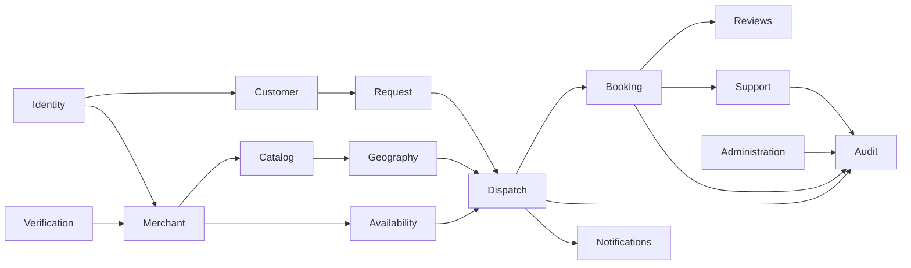

# Backend domain responsibilities

Status: CONCEPTUAL PHASE 00 BLUEPRINT. Prepared 2026-10-15 under owner-delegated scope expansion. Detailed contracts and technical approval belong to Phases 03 and 04. These are proposed responsibilities, not implemented services.

## Domain dependency diagram

Arrows show allowed responsibility dependencies, not unrestricted database access. Dispatch asks about eligibility and reserves capacity together with assignment; Notifications consumes committed events asynchronously. Administration invokes audited domain commands rather than directly patching rows.

## Domain reference

| Domain | Ownership and principal entities | Allowed interaction and failure boundary | Future owner phase |
|---|---|---|---|
| Identity | User, credentials/session reference, role grants | Synchronous subject verification; expired session denies access, never grants fallback privilege | 10 |
| Customer | CustomerProfile, consent/language/address references | Own-subject updates; idempotent profile mutation, no merchant private data | 10–11 |
| Merchant | Merchant, MerchantMember, Technician | Tenant-scoped membership/capabilities; revoked grants immediately block privileged writes | 11 |
| Catalog | ServiceCategory, MerchantService | Approved category and verified disclosure; absent price remains unavailable | 11 |
| Geography | ServiceArea, location precision policy | City/zone eligibility; unknown coordinates require clarification, not fabricated proximity | 11 |
| Availability | Hours, Availability, Capacity | Reservable capacity with consistent units/time windows; stale online hints cannot allocate work | 11–12 |
| Request | ServiceRequest, client idempotency key | Canonical creation and scheduling; equivalent retries return same request, mismatched payload rejects | 12 |
| Dispatch | DispatchOffer, Assignment, reservation | Single winner transaction, expiry and generation checks; races/failed commits return deterministic outcome | 12 |
| Booking | Booking, BookingEvent | Legal lifecycle commands; quote/customer-consent policy pending; replay does not advance twice | 13 |
| Notifications | Notification, attempts, outbox consumer offset | Async delivery and deduplication; provider outages do not roll back committed assignment | 14 |
| Verification | VerificationCase, evidence reference | Assigned reviewer only; audit decisions, recheck approval before assignment | 11 |
| Reviews | Review, moderation case | Request-linked eligibility and abuse checks; no invented rating, removal is policy-gated | 13 |
| Support | Dispute, complaint, escalation | Case-scoped access; preserve history, escalation timers await approved support model | 13–17 |
| Administration | Governed commands/config versions | MFA and explicit grants; no self-elevation or unaudited emergency override | 10–17 |
| Audit | AuditEvent, immutable correlation | Append-only corrections; restrict exports, redact unnecessary sensitive payloads | 10–17 |

## Contract and isolation rules

A domain owns mutation of its entities; shared transactions are orchestrated through explicit commands rather than arbitrary table access. Tenant/subject context travels with every synchronous call and queued event. Idempotency keys bind actor, operation and payload; provider message IDs are delivery evidence, not account identity. Async handlers tolerate duplicate/out-of-order events and reconcile against current versions. Cross-tenant tests, concurrency tests, retention decisions and exact error/API schemas remain Phase 03/10–17 work. See [state machines](../flows/state-machines.md) and [traceability](../blueprint/traceability-matrix.md).
