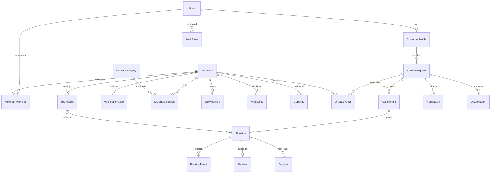

# Conceptual data architecture

Status: CONCEPTUAL PHASE 00 BLUEPRINT. Prepared 2026-10-15 under owner-delegated scope expansion. Detailed contracts and technical approval belong to Phases 03 and 04. These are proposed responsibilities, not implemented services.

## Conceptual entity relationships

Relationships express candidate ownership, not a final schema. A request has at most one current assignment; reassignment requires preserving prior generations/history, not creating two active winners. A booking links customer and merchant under different visibility rules. Notifications and outbox events refer to the request so retries can reconcile to authoritative state.

## Invariants and sensitive data

Unique active assignment per request/generation, nonnegative available capacity, atomic reservation/assignment, one logical request per actor idempotency key, tenant-scoped membership and versioned legal transitions are business invariants. Exact constraints, indexes, columns and locking strategy require Phase 03 proof. Scheduled capacity must use an approved time-window model; current capacity alone cannot promise future availability.

Contact details, precise address/location, verification documents, communications and photos are sensitive. Store evidence references rather than duplicate binary data in events. Signed/scoped access, upload validation, malware checks and safe audit redaction are requirements, not tested controls. Review/public catalog data must be separated from private evidence. Retention/deletion/export/legal-hold durations remain OPEN; deletion must not erase required accounting/audit history by accident. Phase 01 legal analysis and Phase 02 policy precede Phase 03 schema approval.

## Provenance and change control

Booking/audit events record actor, reason, version and correlation without unnecessary personal content. Outbox entries are committed with business transitions; consumer processing is idempotent. Historical roadmap hashes live in the governance manifest, not the application database. See [privacy flow](../flows/privacy-rights.md), [security](security-trust-boundaries.md) and [Phase 03](../roadmap/workstreams/system-architecture.md).
