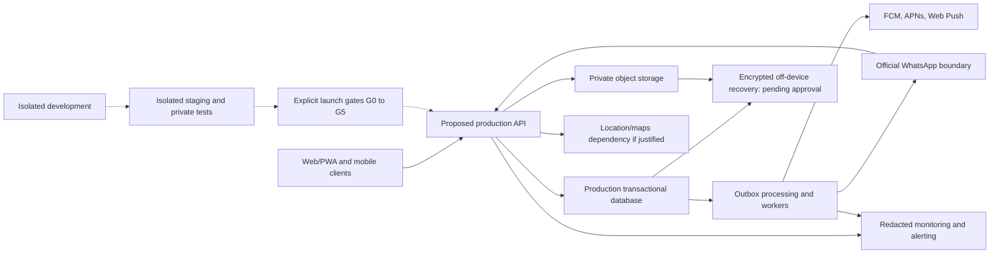

# Conceptual deployment and integrations

Status: CONCEPTUAL PHASE 00 BLUEPRINT. Prepared 2026-10-15 under owner-delegated scope expansion. Detailed contracts and technical approval belong to Phases 03 and 04. These are proposed responsibilities, not implemented services.

## Deployment diagram

Solid arrows show runtime responsibilities; dotted arrows show gated promotion, not shared production credentials/data. Development and staging require separate identities, storage and safe test fixtures. An outbox-backed worker can start without a separately purchased queue. A cache is optional for read acceleration only and cannot decide winning assignment or capacity. No cloud resources are provisioned by this blueprint.

## Integration feasibility register

| Dependency | Must verify before commitment | Failure and cost boundary | Responsible phase |
|---|---|---|---|
| Official WhatsApp | Account eligibility, terms, credentials, consent/templates and export/integration ownership | Delivery limits, callback verification, opt-out and retry costs; backend state survives outage | 01, 03, 14 |
| FCM/APNs/Web Push | Platform entitlements, token ownership/revocation and privacy | Delivery is uncertain; stale message deep links fetch current authorized state | 03, 14, 16 |
| Maps/location | Precision, coverage, permitted usage, quota and price | Manual address clarification if unknown; avoid false proximity | 01, 03, 11 |
| App Store/Play Store | Developer accounts, policies, required disclosures and review | Publication not guaranteed; coordinated launch waits for approved channel readiness | 01, 16, 18 |
| Lovable/export | Separate approved design, standalone project/export terms and bounded compatibility proof | Existing project untouched; no assumed repository import | 06–08 |
| Hosting/storage/monitoring | Team capability, region/data policy, encryption, access, cost and restore feasibility | Failover, recovery objectives and retention are unapproved | 01, 03, 09, 17 |

Repository Git bundles protect selected historical commits only. Future disaster recovery needs encrypted off-device copies, access review, retention and a tested restore of the approved final baseline. No vendor is selected. See [continuity requirements](../product/requirements/non-functional.md), [phase plans](../phases/README.md) and [notification flow](../flows/flow-08-notifications.md).
