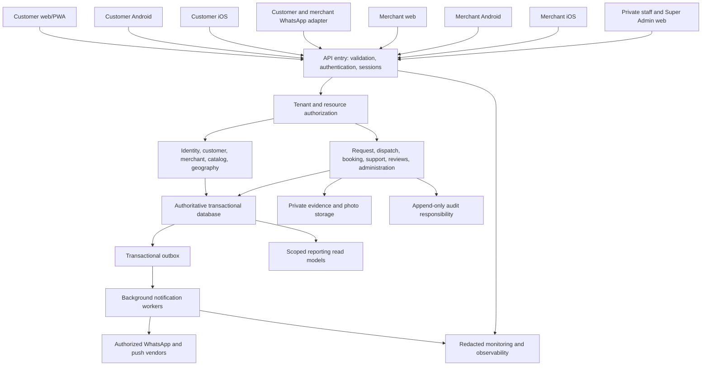

# High-level platform architecture

Status: CONCEPTUAL PHASE 00 BLUEPRINT. Prepared 2026-10-15 under owner-delegated scope expansion. Detailed contracts and technical approval belong to Phases 03 and 04. These are proposed responsibilities, not implemented services.

## Platform diagram

Every interactive channel crosses the same authentication and authorization boundary. Request, dispatch and booking modules own their respective transitions in the database; a reporting projection or notification cannot override them. The outbox saves an event with the state-changing transaction so a crash cannot silently lose the intent to notify. Workers may retry delivery without retrying the business transition.

## Proposed responsibilities

A modular monolith is a starting proposal: one deployment with explicit module contracts and one transactional consistency boundary. This simplifies first acceptance and capacity reservation; trade-offs include coordinated deployment and the need to prevent accidental cross-module writes. Node/Fastify/TypeScript and PostgreSQL/PostGIS remain DEC-012 proposals pending feasibility and Phase 03 proof. An API gateway can be an entry module rather than a paid separate service. Private object storage carries upload scanning/access/retention duties; it is not a public asset bucket. Reporting is permission-scoped and eventually consistent; audit records preserve actor, reason, request correlation and transition outcome. Observability redacts location, messages and evidence.

Search combines catalog, geography, verification, hours, availability and capacity, but results are hints; dispatch rechecks eligibility at commit. Notifications persist delivery attempts, retry limits and provider outcome without claiming that receipt means acceptance. Sessions, MFA and machine identities are specified before any integration. See [domains](backend-domains.md), [data](data-architecture.md), [deployment](deployment-and-integrations.md) and [atomic acceptance](../flows/atomic-acceptance.md).
