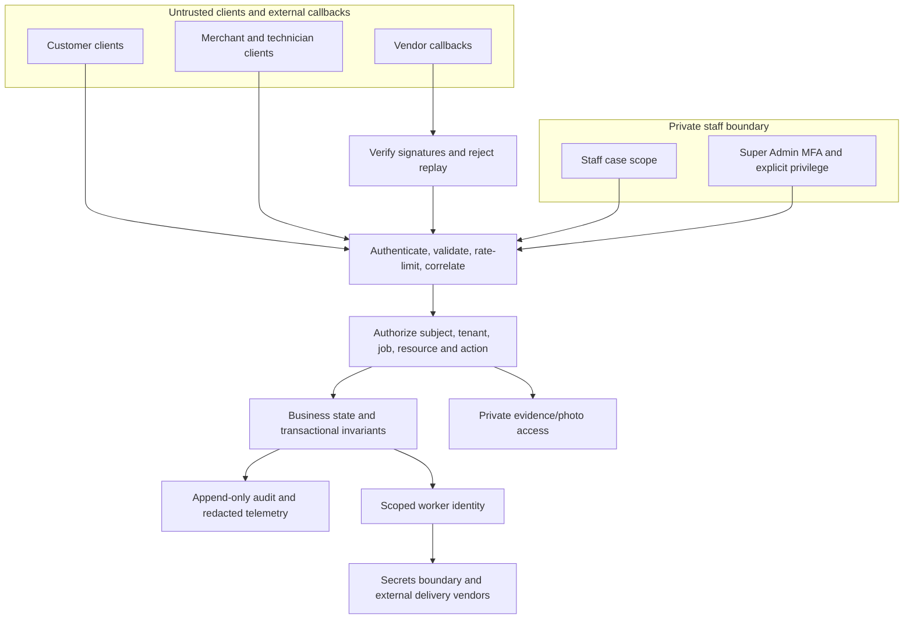

# Security and trust boundaries

Status: CONCEPTUAL PHASE 00 BLUEPRINT. Prepared 2026-10-15 under owner-delegated scope expansion. Detailed contracts and technical approval belong to Phases 03 and 04. These are proposed responsibilities, not implemented services.

## Trust-boundary diagram

No client-provided tenant ID, callback status or UI click is trusted as authority. The backend checks both identity and resource scope before actions or private data access. Workers use narrow machine credentials; staff authentication does not imply unrestricted customer evidence access. Secrets stay outside tracked documentation and notification payloads.

## Required controls and remaining threat work

Customer ownership, merchant tenant separation, technician assigned-job access and assigned reviewer/support case scope follow PERM-001 through PERM-006. Privileged MFA/session recovery, separation of duties and a reason/audit trail constrain admin actions. Emergency access needs separately approved duration, dual control and post-event review; no bypass exists by assumption.

Phase 03 must enumerate assets, data flows and threats: account takeover, forged callback/replay, cross-tenant object access, unsafe uploads, location leakage, fraudulent merchant evidence, double assignment, capacity races, notification spoofing, staff abuse, deletion/retention conflict and service denial. Phases 10–17 must test deny paths as well as happy paths; missing/revoked permission fails closed. Consent and opt-out affect notifications without silently cancelling work. Repository scans and diagrams are not security certification. NFR-SEC-001/002/003, NFR-OBS-001 and NFR-EXT-001 apply. See [access model](../security/access-control.md), [authentication flow](../flows/flow-09-authentication.md) and [open decisions](../blueprint/open-decisions.md).
