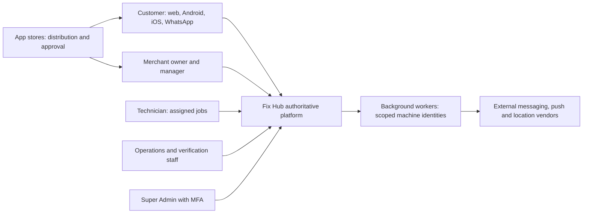

# Fix Hub system context

Status: CONCEPTUAL PHASE 00 BLUEPRINT. Prepared 2026-10-15 under owner-delegated scope expansion. Detailed contracts and technical approval belong to Phases 03 and 04. These are proposed responsibilities, not implemented services.

Fix Hub coordinates local services in Tanuku. Customers request help; verified merchants offer capacity; assigned technicians perform work. Operations handle exceptions, reviewers verify merchants, and Super Admin governs privileged configuration. A merchant manager acts only within the owner's explicit delegation.

## Context diagram

The platform is the decision boundary between people and external delivery systems. Workers deliver committed events; they cannot invent assignments. Stores distribute clients and can constrain publication, but never decide request state. Each arrow represents authenticated communication or distribution, not an approved vendor contract.

## Actors, boundaries and safety

Customer data is scoped to its subject and requests. Merchant owners/managers are scoped to one merchant; technicians see assigned-job fields only. Operations and reviewers require case scope, reasons and auditable actions. Super Admin access is private, privileged and MFA-gated. Public clients and provider callbacks are untrusted inputs; signatures, authentication, replay detection and authorization are future design requirements. Private verification evidence/photos must not be exposed through public catalog results.

## Dependencies and ownership

FR-X-001, FR-C-004, FR-M-007, FR-A-005 and NFR-SEC-001/002 guide these boundaries. Vendor consent, eligibility, credentials, costs, quotas and store approval remain unverified in Phase 01. Phase 03 specifies identity contracts; Phase 04 specifies interactions; Phases 10–18 implement/test. See [platform](platform-overview.md), [security](security-trust-boundaries.md) and [reader guide](../blueprint/README.md).
