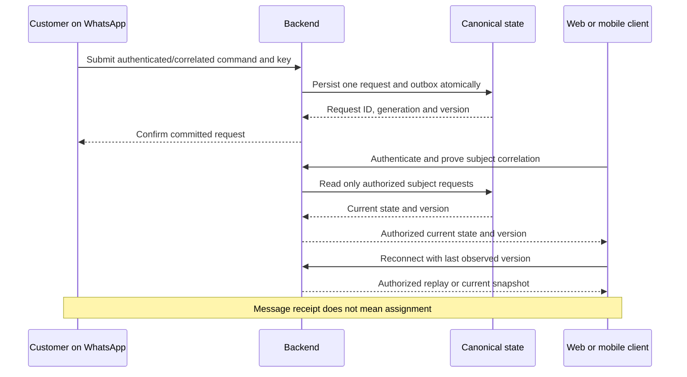

# Cross-channel continuity

Status: CONCEPTUAL PHASE 00 BLUEPRINT. Web/PWA, Android, iOS and official WhatsApp share backend-owned state. Identity correlation is a proposed contract to validate in Phases 03/04/10/14.

## Continuity diagram

A person can continue a WhatsApp request on another channel only after proving a safe identity relationship. A phone number, push token, guessed request ID or merchant message alone is not proof. Requests, merchant membership and service identities have canonical backend IDs; provider identifiers are mapped under verified ownership and revocation rules. Merchant continuity is tenant-scoped; a manager's revoked delegation is checked on every command.

## Contracts and failure behavior

1. An idempotency key binds subject, command and payload. Equivalent retries return the original result; changed payload with the same key rejects.
2. Commands include current version/generation where needed. Concurrent acceptance is decided transactionally, not by whichever notification arrived first.
3. After reconnect, fetch a fresh authorized snapshot or replay permitted events from a known cursor. Missing/expired cursor falls back to snapshot, never unbounded personal-data replay.
4. Queue delivery and provider callbacks may be duplicated, late, missing or reordered. Store event correlation and outcomes; suppress expired messages and reconcile current state.
5. Offline clients display a timestamp/stale indicator. Unconfirmed actions remain pending locally and cannot advertise a winning assignment. A safe retry confirms committed state before a second user action.
6. Consent and opt-out apply per purpose/channel. Account correlation does not manufacture WhatsApp consent. Permission checks apply again during replay and notification addressing.
7. Crash before commit leaves no business effect; crash after commit uses saved command results and outbox replay. System recovery reconciles capacity/assignment before publishing status.

## Decisions and future evidence

Account linking, shared-device handling, number recycling, cursor retention, consent language, message TTL and channel fallback remain OPEN. Phase 03 specifies APIs/data; Phase 04 finalizes journeys; Phases 10/12/14/16 test login, spoofed identity, duplicate request, reconnect, generation races and notification expiry on real channels. FR-C-004, FR-X-001, FR-M-008, NFR-REL-001, NFR-SEC-001/002 and NFR-EXT-001 apply. See [authentication](flow-09-authentication.md), [notifications](flow-08-notifications.md), [state machines](state-machines.md) and [reader guide](../blueprint/README.md).
