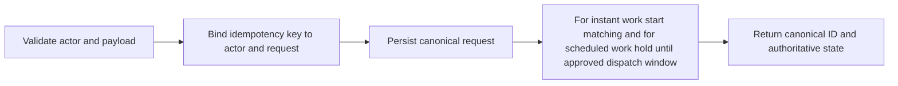

# FLOW 02 — Customer service request

Status: CONCEPTUAL PHASE 00 BLUEPRINT, 2026-10-15. No runtime or policy approval is implied.

## Objective, trigger and actors

Business objective: Create one actionable instant or scheduled request. Trigger: Customer submits service details and address. Actors: Customer, channel adapter, Request, Dispatch.

## Preconditions

Authorized subject; service area; validated details; approved scheduling policy. Every command checks current actor/resource scope. Phase 03 validates exact transaction/API contracts; Phase 04 validates the detailed interaction.

## Happy path

1. Validate actor and payload.
2. Bind idempotency key to actor and request.
3. Persist canonical request.
4. For instant work start matching and for scheduled work hold until approved dispatch window.
5. Return canonical ID and authoritative state.

## Editable flow diagram

The diagram follows the numbered path above. Each step crosses an explicit responsibility boundary rather than trusting the client. The backend response communicates committed state; notification arrows represent attempted delivery. For atomic acceptance the illustrated A-first result is an example only: whichever valid transaction commits first wins, regardless of network arrival order. A losing result never reserves capacity.

## State and authority

Created to Searching or Scheduled; backend owns creation and dispatch activation. Authoritative state must be read after reconnect and before acting on a stale notification.

## Notifications

Confirm request with canonical ID; searching status follows committed event. Redact private data and respect consent; an unavailable channel must not create a second business command.

## Failure and recovery

Ambiguous submission is retried with same key; mismatched payload rejects; unsupported schedule/timezone clarifies; optional upload failure does not invent photo receipt. Audit actor, reason, version and correlation. Recovery tests must cover duplicates, out-of-order updates and revoked authorization, with real execution evidence in the owning phase.

## Traceability, decisions and phase ownership

Requirements: FR-C-003, FR-C-004, FR-C-005, FR-X-001, NFR-REL-001. Open policy/technical decisions: Schedule horizon, timezone handling, attachment limits and cancellation policy. Owning implementation phase: 12; later-phase execution, provider approvals and acceptance tests are PENDING. Related: [state machines](state-machines.md), [channel continuity](cross-channel-continuity.md), [blueprint index](../blueprint/README.md).
