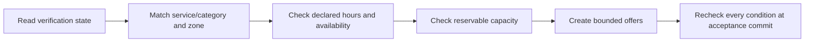

# FLOW 03 — Merchant discovery and eligibility

Status: CONCEPTUAL PHASE 00 BLUEPRINT, 2026-10-15. No runtime or policy approval is implied.

## Objective, trigger and actors

Business objective: Exclude unsafe or unavailable providers before an offer. Trigger: Dispatch needs a candidate set. Actors: Merchant, Verification, Catalog, Geography, Availability, Dispatch.

## Preconditions

Merchant approved; active services and allowed geography. Every command checks current actor/resource scope. Phase 03 validates exact transaction/API contracts; Phase 04 validates the detailed interaction.

## Happy path

1. Read verification state.
2. Match service/category and zone.
3. Check declared hours and availability.
4. Check reservable capacity.
5. Create bounded offers.
6. Recheck every condition at acceptance commit.

## Editable flow diagram

The diagram follows the numbered path above. Each step crosses an explicit responsibility boundary rather than trusting the client. The backend response communicates committed state; notification arrows represent attempted delivery. For atomic acceptance the illustrated A-first result is an example only: whichever valid transaction commits first wins, regardless of network arrival order. A losing result never reserves capacity.

## State and authority

Candidate to Offered is not Assigned; database-backed eligibility is authoritative. Authoritative state must be read after reconnect and before acting on a stale notification.

## Notifications

Send scoped offers with expiry and current-state lookup. Redact private data and respect consent; an unavailable channel must not create a second business command.

## Failure and recovery

Revoked verification, closed hours, unknown zone or full capacity excludes; stale cache is never acceptance authority; scheduled capacity requires approved time model. Audit actor, reason, version and correlation. Recovery tests must cover duplicates, out-of-order updates and revoked authorization, with real execution evidence in the owning phase.

## Traceability, decisions and phase ownership

Requirements: FR-M-002, FR-M-003, FR-M-004, FR-X-002, NFR-SEC-003. Open policy/technical decisions: Capacity units, future reservations, distance rule and offer fanout. Owning implementation phase: 11–12; later-phase execution, provider approvals and acceptance tests are PENDING. Related: [state machines](state-machines.md), [channel continuity](cross-channel-continuity.md), [blueprint index](../blueprint/README.md).
