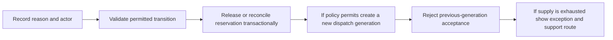

# FLOW 06 — Cancellation and reassignment

Status: CONCEPTUAL PHASE 00 BLUEPRINT, 2026-10-15. No runtime or policy approval is implied.

## Objective, trigger and actors

Business objective: End or recover a booking safely while preserving history. Trigger: Customer/merchant cancellation, no-show or timeout. Actors: Customer, merchant, technician, ops, Dispatch, Booking.

## Preconditions

Authorized actor; current version; approved cancellation/override policy. Every command checks current actor/resource scope. Phase 03 validates exact transaction/API contracts; Phase 04 validates the detailed interaction.

## Happy path

1. Record reason and actor.
2. Validate permitted transition.
3. Release or reconcile reservation transactionally.
4. If policy permits create a new dispatch generation.
5. Reject previous-generation acceptance.
6. If supply is exhausted show exception and support route.

## Editable flow diagram

The diagram follows the numbered path above. Each step crosses an explicit responsibility boundary rather than trusting the client. The backend response communicates committed state; notification arrows represent attempted delivery. For atomic acceptance the illustrated A-first result is an example only: whichever valid transaction commits first wins, regardless of network arrival order. A losing result never reserves capacity.

## State and authority

Cancelled or Exception; reassignment never has two current assignments; backend owns generation and capacity. Authoritative state must be read after reconnect and before acting on a stale notification.

## Notifications

Notify affected parties after commit; late messages display current state. Redact private data and respect consent; an unavailable channel must not create a second business command.

## Failure and recovery

Cancel/accept race serializes; replay reconciles; no-show is a reported exception until verified; dispute stays linked to original booking; compensation/fines are not assumed. Audit actor, reason, version and correlation. Recovery tests must cover duplicates, out-of-order updates and revoked authorization, with real execution evidence in the owning phase.

## Traceability, decisions and phase ownership

Requirements: FR-C-007, FR-M-005, FR-M-007, FR-A-004, NFR-REL-001, NFR-OPS-001. Open policy/technical decisions: Cutoffs, reassignment consent, no-show evidence and emergency powers. Owning implementation phase: 12–13; later-phase execution, provider approvals and acceptance tests are PENDING. Related: [state machines](state-machines.md), [channel continuity](cross-channel-continuity.md), [blueprint index](../blueprint/README.md).
