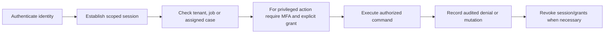

# FLOW 09 — Authentication and authorization

Status: CONCEPTUAL PHASE 00 BLUEPRINT, 2026-10-15. No runtime or policy approval is implied.

## Objective, trigger and actors

Business objective: Give each actor only approved resource actions. Trigger: Login or authenticated command/private-data request. Actors: Customer, merchant, technician, staff, Super Admin, Identity.

## Preconditions

Verified authentication method; identity mapping; privileged MFA and session policy. Every command checks current actor/resource scope. Phase 03 validates exact transaction/API contracts; Phase 04 validates the detailed interaction.

## Happy path

1. Authenticate identity.
2. Establish scoped session.
3. Check tenant, job or assigned case.
4. For privileged action require MFA and explicit grant.
5. Execute authorized command.
6. Record audited denial or mutation.
7. Revoke session/grants when necessary.

## Editable flow diagram

The diagram follows the numbered path above. Each step crosses an explicit responsibility boundary rather than trusting the client. The backend response communicates committed state; notification arrows represent attempted delivery. For atomic acceptance the illustrated A-first result is an example only: whichever valid transaction commits first wins, regardless of network arrival order. A losing result never reserves capacity.

## State and authority

Session and grant version are backend-owned; role labels alone do not authorize. Authoritative state must be read after reconnect and before acting on a stale notification.

## Notifications

Sensitive account/security notices through approved safe channels. Redact private data and respect consent; an unavailable channel must not create a second business command.

## Failure and recovery

Expired/revoked session reauthenticates; deny cross-tenant/job access; account recovery never self-grants admin; callback signatures do not replace subject authorization. Audit actor, reason, version and correlation. Recovery tests must cover duplicates, out-of-order updates and revoked authorization, with real execution evidence in the owning phase.

## Traceability, decisions and phase ownership

Requirements: FR-A-005, FR-M-007, NFR-SEC-001, NFR-SEC-002. Open policy/technical decisions: Customer login factors, technician independent login, MFA/recovery and device session policy. Owning implementation phase: 10; later-phase execution, provider approvals and acceptance tests are PENDING. Related: [state machines](state-machines.md), [channel continuity](cross-channel-continuity.md), [blueprint index](../blueprint/README.md).
