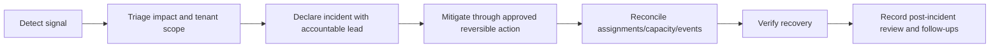

# FLOW 11 — Platform operations and incidents

Status: CONCEPTUAL PHASE 00 BLUEPRINT, 2026-10-15. No runtime or policy approval is implied.

## Objective, trigger and actors

Business objective: Restore safe service and retain incident evidence. Trigger: Monitor or person detects fault/abuse. Actors: On-call operations, authorized engineering/security, Super Admin.

## Preconditions

Approved access/runbooks; redacted telemetry and correlation. Every command checks current actor/resource scope. Phase 03 validates exact transaction/API contracts; Phase 04 validates the detailed interaction.

## Happy path

1. Detect signal.
2. Triage impact and tenant scope.
3. Declare incident with accountable lead.
4. Mitigate through approved reversible action.
5. Reconcile assignments/capacity/events.
6. Verify recovery.
7. Record post-incident review and follow-ups.

## Editable flow diagram

The diagram follows the numbered path above. Each step crosses an explicit responsibility boundary rather than trusting the client. The backend response communicates committed state; notification arrows represent attempted delivery. For atomic acceptance the illustrated A-first result is an example only: whichever valid transaction commits first wins, regardless of network arrival order. A losing result never reserves capacity.

## State and authority

Incident Detected to Investigating to Mitigating to Recovering to Reviewed; business states remain domain-owned. Authoritative state must be read after reconnect and before acting on a stale notification.

## Notifications

Communicate verified impact; no invented recovery ETA; retries controlled during outage. Redact private data and respect consent; an unavailable channel must not create a second business command.

## Failure and recovery

Queue backlog, provider outage and database failure require distinct recovery; no admin direct-row patch; break-glass policy pending; telemetry must not leak private evidence. Audit actor, reason, version and correlation. Recovery tests must cover duplicates, out-of-order updates and revoked authorization, with real execution evidence in the owning phase.

## Traceability, decisions and phase ownership

Requirements: FR-A-003, FR-A-006, NFR-OBS-001, NFR-BCP-001, NFR-OPS-001. Open policy/technical decisions: On-call staffing, incident severity, SLO/RPO/RTO and emergency approvals. Owning implementation phase: 17; later-phase execution, provider approvals and acceptance tests are PENDING. Related: [state machines](state-machines.md), [channel continuity](cross-channel-continuity.md), [blueprint index](../blueprint/README.md).
