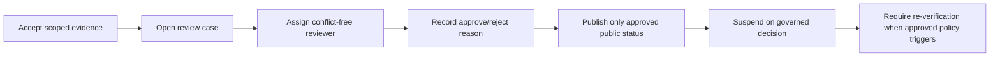

# FLOW 07 — Merchant verification

Status: CONCEPTUAL PHASE 00 BLUEPRINT, 2026-10-15. No runtime or policy approval is implied.

## Objective, trigger and actors

Business objective: Review evidence before eligibility without false verification. Trigger: Merchant submits business evidence. Actors: Owner/manager, assigned reviewer, admin, Verification.

## Preconditions

Authenticated tenant and safe private upload; approved evidence policy. Every command checks current actor/resource scope. Phase 03 validates exact transaction/API contracts; Phase 04 validates the detailed interaction.

## Happy path

1. Accept scoped evidence.
2. Open review case.
3. Assign conflict-free reviewer.
4. Record approve/reject reason.
5. Publish only approved public status.
6. Suspend on governed decision.
7. Require re-verification when approved policy triggers.

## Editable flow diagram

The path shows evidence submission and authorized review. Submission or a public rating does not verify a merchant. The diagram is conceptual, not an exhaustive trust-boundary or implementation proof.

## State and authority

Draft to Submitted to UnderReview to Approved/Rejected; Approved may become Suspended; reviewer command owns state. Authoritative state must be read after reconnect and before acting on a stale notification.

## Notifications

Tell merchant status and action needed; exclude private documents from message body. Redact private data and respect consent; an unavailable channel must not create a second business command.

## Failure and recovery

Unsafe/incomplete upload returns guidance; reviewer outage leaves pending; revocation excludes new acceptance; active jobs route to safety/ops policy. Audit actor, reason, version and correlation. Recovery tests must cover duplicates, out-of-order updates and revoked authorization, with real execution evidence in the owning phase.

## Traceability, decisions and phase ownership

Requirements: FR-M-001, FR-M-002, FR-A-002, NFR-SEC-002. Open policy/technical decisions: Evidence types, masking, reviewer conflicts, appeal and re-verification cadence. Owning implementation phase: 11; later-phase execution, provider approvals and acceptance tests are PENDING. Related: [state machines](state-machines.md), [channel continuity](cross-channel-continuity.md), [blueprint index](../blueprint/README.md).
