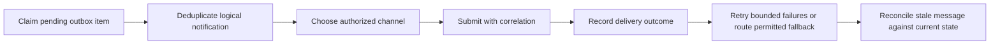

# FLOW 08 — Notifications and recovery

Status: CONCEPTUAL PHASE 00 BLUEPRINT, 2026-10-15. No runtime or policy approval is implied.

## Objective, trigger and actors

Business objective: Deliver truthful updates without coupling delivery to business success. Trigger: A business transition commits with an outbox event. Actors: Domain module, outbox worker, provider, authorized recipient.

## Preconditions

Committed event; valid recipient mapping; consent/opt-out and approved channel rules. Every command checks current actor/resource scope. Phase 03 validates exact transaction/API contracts; Phase 04 validates the detailed interaction.

## Happy path

1. Claim pending outbox item.
2. Deduplicate logical notification.
3. Choose authorized channel.
4. Submit with correlation.
5. Record delivery outcome.
6. Retry bounded failures or route permitted fallback.
7. Reconcile stale message against current state.

## Editable flow diagram

The path shows notification delivery and recovery attempts. Delivery or acknowledgement never changes the committed business result. The diagram is conceptual, not an exhaustive trust-boundary or implementation proof.

## State and authority

Queued to Sent/Delivered/Failed/Expired; provider delivery is uncertain and separate from booking state. Authoritative state must be read after reconnect and before acting on a stale notification.

## Notifications

Channels include WhatsApp, web, Android/iOS push; never require all clients open. Redact private data and respect consent; an unavailable channel must not create a second business command.

## Failure and recovery

Outage/replay uses idempotent processing; reordered events fetch current version; consent withdrawal suppresses prohibited sends; dead-letter operations cannot silently lose business state. Audit actor, reason, version and correlation. Recovery tests must cover duplicates, out-of-order updates and revoked authorization, with real execution evidence in the owning phase.

## Traceability, decisions and phase ownership

Requirements: FR-M-008, FR-X-004, NFR-EXT-001, NFR-OBS-001, NFR-REL-001. Open policy/technical decisions: Retry budget, TTL, channel precedence, consent basis and escalation timing. Owning implementation phase: 14; later-phase execution, provider approvals and acceptance tests are PENDING. Related: [state machines](state-machines.md), [channel continuity](cross-channel-continuity.md), [blueprint index](../blueprint/README.md).
