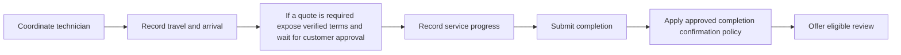

# FLOW 05 — Complete service lifecycle

Status: CONCEPTUAL PHASE 00 BLUEPRINT, 2026-10-15. No runtime or policy approval is implied.

## Objective, trigger and actors

Business objective: Track fulfilment without fabricated price or arrival. Trigger: An assignment is committed. Actors: Customer, merchant, technician, Booking.

## Preconditions

Assigned merchant and permitted technician; quote policy and customer approval rules defined before implementation. Every command checks current actor/resource scope. Phase 03 validates exact transaction/API contracts; Phase 04 validates the detailed interaction.

## Happy path

1. Coordinate technician.
2. Record travel and arrival.
3. If a quote is required expose verified terms and wait for customer approval.
4. Record service progress.
5. Submit completion.
6. Apply approved completion confirmation policy.
7. Offer eligible review.

## Editable flow diagram

The path shows authorized service updates and persisted outcomes. Client messages alone cannot advance canonical state. The diagram is conceptual, not an exhaustive trust-boundary or implementation proof.

## State and authority

Assigned to Coordinating to Arrived to InProgress to Completed; Booking owns transitions and versions. Authoritative state must be read after reconnect and before acting on a stale notification.

## Notifications

Notify meaningful committed progress; show uncertainty instead of guaranteed ETA. Redact private data and respect consent; an unavailable channel must not create a second business command.

## Failure and recovery

Quote rejection or safety concern routes to support/cancellation; duplicate updates do not advance twice; disconnected technician syncs against latest state. Audit actor, reason, version and correlation. Recovery tests must cover duplicates, out-of-order updates and revoked authorization, with real execution evidence in the owning phase.

## Traceability, decisions and phase ownership

Requirements: FR-C-005, FR-C-006, FR-C-007, FR-M-007, FR-X-003, FR-X-005. Open policy/technical decisions: Quotes, inspection charge, completion confirmation, direct-payment records and guarantee policy remain OPEN. Owning implementation phase: 13; later-phase execution, provider approvals and acceptance tests are PENDING. Related: [state machines](state-machines.md), [channel continuity](cross-channel-continuity.md), [blueprint index](../blueprint/README.md).
