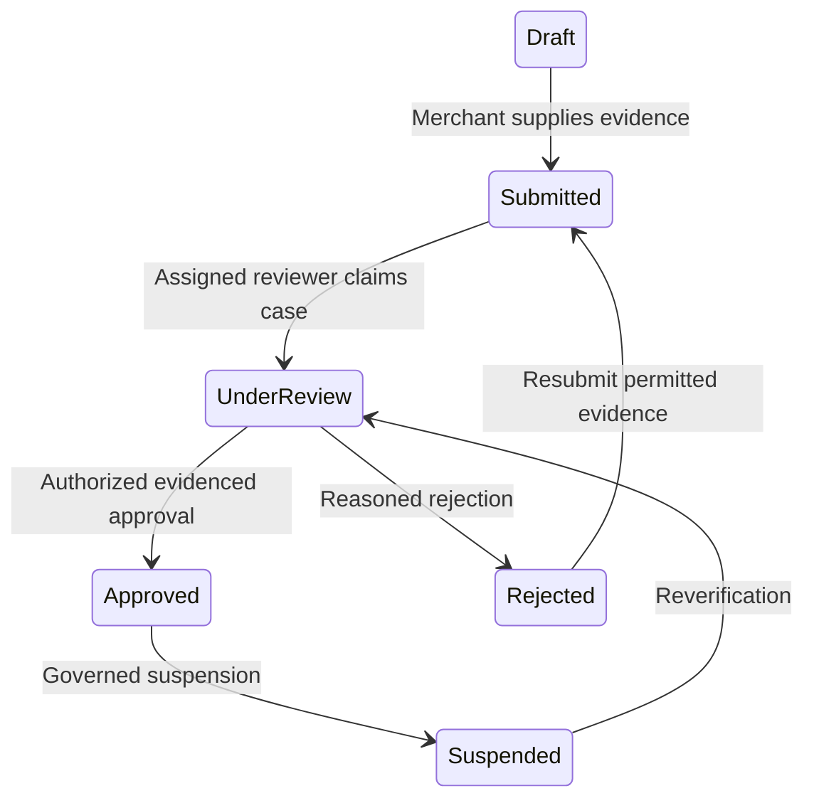
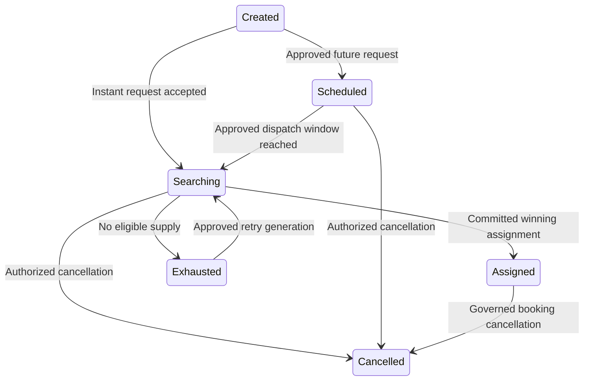
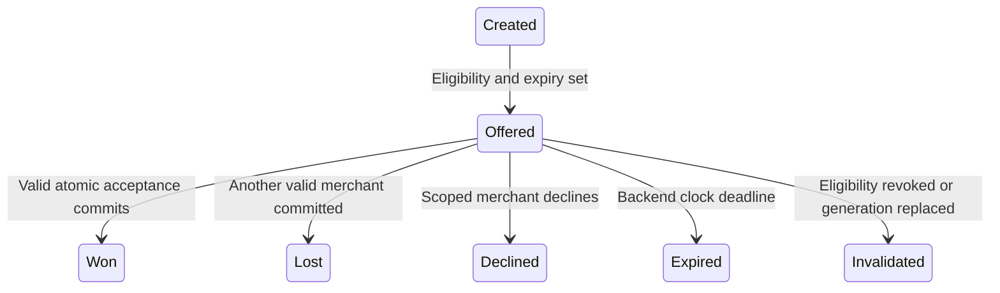
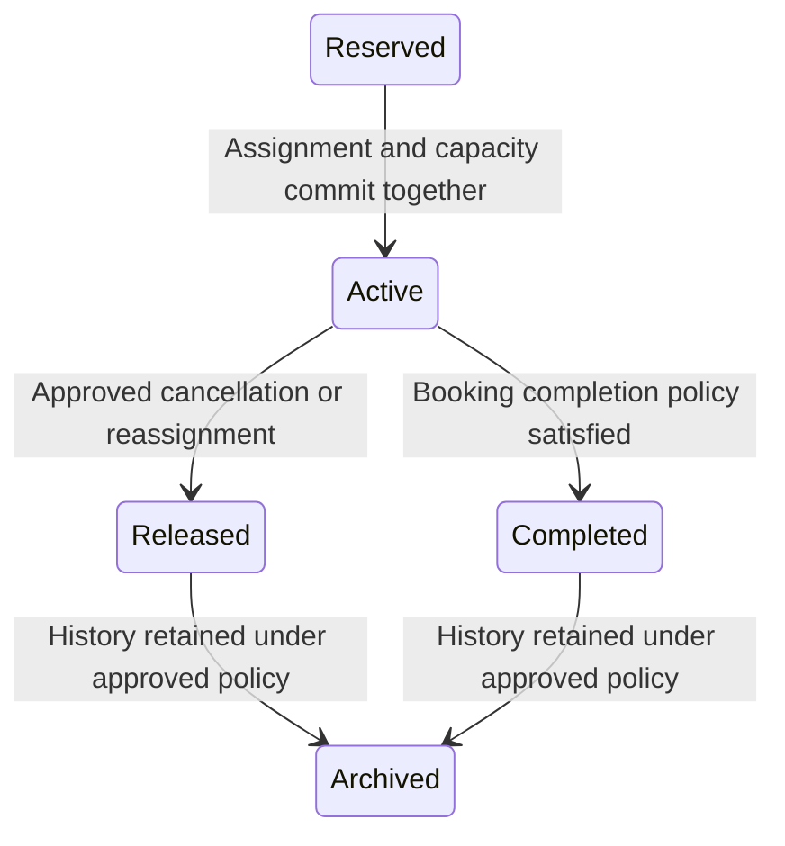
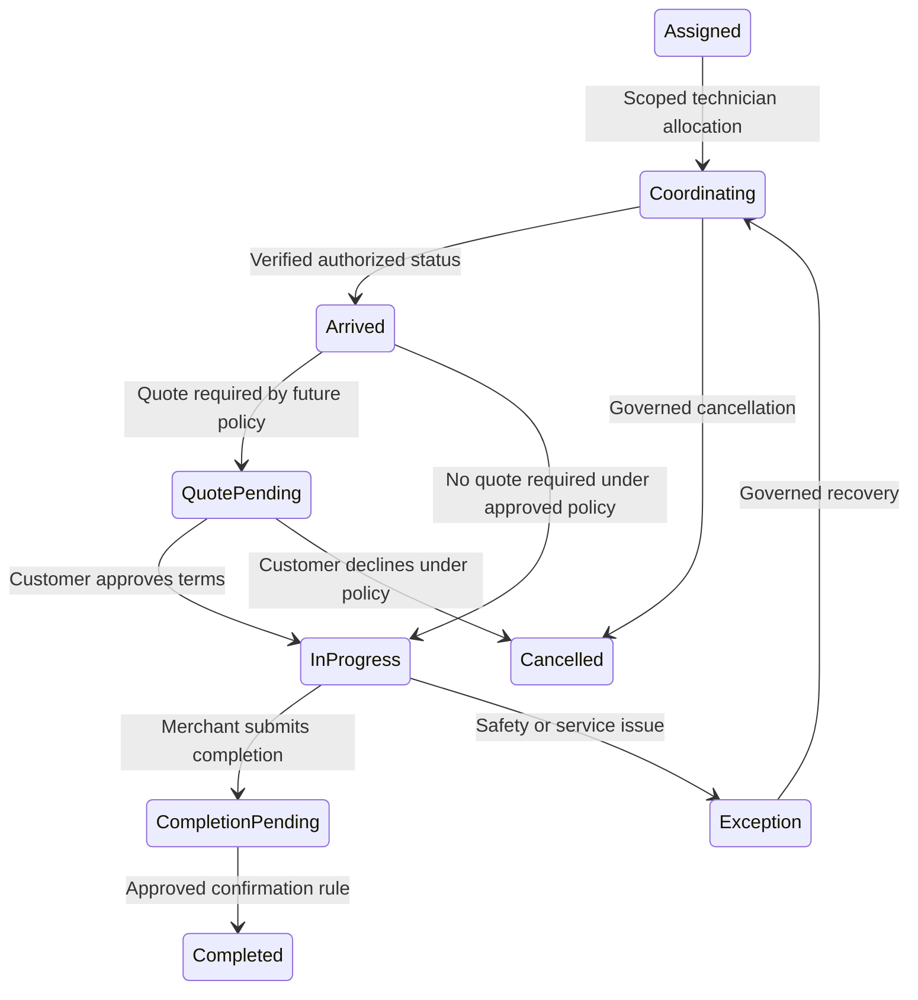
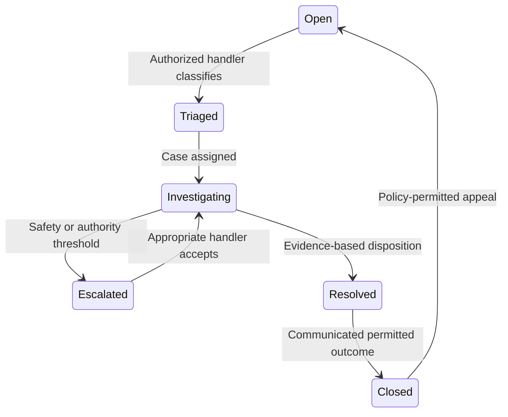

# Conceptual state machines

Status: CONCEPTUAL PHASE 00 BLUEPRINT. Phase 04 approves detailed transitions; Phase 03 owns state/version contracts. All timers, policies and emergency actions remain subject to explicit approval. No implementation proof is claimed.

## Merchant verification

Verification owns status. Only assigned reviewers/admin can decide; merchant can submit evidence. Submission never auto-approves; suspension cannot silently erase active work. Review expiry, appeal and re-verification periods remain OPEN. Missing evidence stays pending. FR-M-002, FR-A-002. Each arrow names a legal conceptual trigger; all unspecified transitions are forbidden by default. Every command rechecks actor scope and current state/version. A delayed notification cannot rewind the machine. Implementation tests must exercise every edge, deny forbidden edges, and race timeouts with state changes. The text is the accessible reading of the diagram.

## Service request

Internal Scheduled means a requested future window, not a reserved or confirmed visit. Customer wording must say future window requested. Only a committed eligible provider and resource interval confirm an assignment; a request receipt confirms capture only. Scheduling and commercial timing policies still require approval.

Request owns canonical identity and generation. `Scheduled` means the request is accepted for a future window; it does not mean a merchant, technician, or capacity interval is reserved. Assignment/reservation is a separate backend-committed outcome. Customer/authorized support creates or cancels; system activates approved scheduled windows. A channel retry cannot create a new logical request; an expired previous generation cannot assign. Matching timeout and retry limits remain OPEN. FR-C-003/005, NFR-REL-001. Each arrow names a legal conceptual trigger; all unspecified transitions are forbidden by default. Every command rechecks actor scope and current state/version. A delayed notification cannot rewind the machine. Implementation tests must exercise every edge, deny forbidden edges, and race timeouts with state changes. The text is the accessible reading of the diagram.

## Dispatch offer

Dispatch owns outcomes. Merchant attempts commands; backend decides Won/Lost. Expired, declined or invalidated offers cannot become Won; changing clocks on a client has no effect. TTL and fanout are pending Phase 02/03 decisions. Offer invalidation races serialize with acceptance. FR-M-004/005/006. Each arrow names a legal conceptual trigger; all unspecified transitions are forbidden by default. Every command rechecks actor scope and current state/version. A delayed notification cannot rewind the machine. Implementation tests must exercise every edge, deny forbidden edges, and race timeouts with state changes. The text is the accessible reading of the diagram.

## Assignment

Dispatch owns active assignment and reservation; Booking owns fulfilment transitions. Reserved is transaction-internal, never a customer-visible promise before commit. Only one current assignment per request/generation. Reassignment creates a fresh generation after release, not Released-to-Active replay. Reservation window/recovery timers remain OPEN. FR-X-002, NFR-SEC-003. Each arrow names a legal conceptual trigger; all unspecified transitions are forbidden by default. Every command rechecks actor scope and current state/version. A delayed notification cannot rewind the machine. Implementation tests must exercise every edge, deny forbidden edges, and race timeouts with state changes. The text is the accessible reading of the diagram.

## Booking lifecycle

Booking owns state/version. Technician reports assigned work; merchant coordinates; customer approves applicable quotes. No fabricated arrival, no auto-consent to a quote and no payment/guarantee implied. Completion rules, no-show timing and cancellation after arrival need policy approval. Repeated progress commands are idempotent. FR-C-005/006/007, FR-M-007. Each arrow names a legal conceptual trigger; all unspecified transitions are forbidden by default. Every command rechecks actor scope and current state/version. A delayed notification cannot rewind the machine. Implementation tests must exercise every edge, deny forbidden edges, and race timeouts with state changes. The text is the accessible reading of the diagram.

## Complaint and dispute

Support owns case status. Reporter submits; case-scoped staff investigates; privileged outcomes need explicit grants. Case closure cannot erase audit or manufacture refund rights. Response/appeal timeouts remain OPEN; safety escalation cannot wait on an unapproved timer. FR-A-004, FR-C-007, NFR-OPS-001. Each arrow names a legal conceptual trigger; all unspecified transitions are forbidden by default. Every command rechecks actor scope and current state/version. A delayed notification cannot rewind the machine. Implementation tests must exercise every edge, deny forbidden edges, and race timeouts with state changes. The text is the accessible reading of the diagram.

## Shared recovery rules

Only committed states are published. Failed transactions reserve nothing. Duplicate/out-of-order events reconcile using canonical ID, generation and version. Cancellation, capacity release and new assignment cannot produce two active reservations. Exact compensations, audit retention and legal holds remain policy decisions. See [atomic acceptance](atomic-acceptance.md), [lifecycle](service-lifecycle.md), [support](support-disputes.md) and [traceability](../blueprint/traceability-matrix.md).
