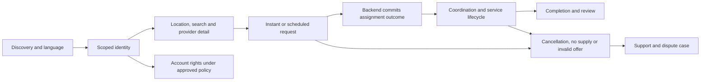
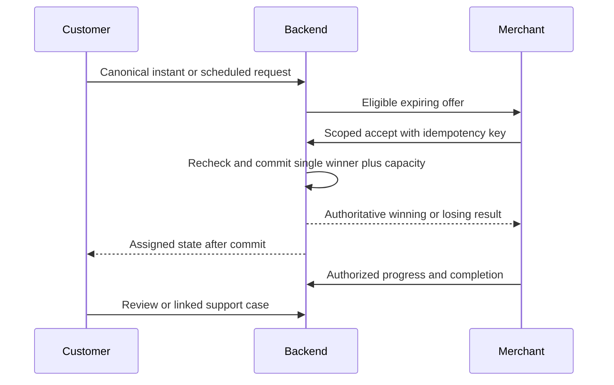

# Customer journey

Status: CONCEPTUAL PHASE 00 BLUEPRINT, 2026-10-15. Interaction names are a proposed registry, not designed or implemented screens. Phase 02 owns business policy, Phase 04 detailed journeys and Phase 06 approved screen specifications.

## Channel and role contracts

| Channel | Entry and continuity | Interaction limits and recovery |
|---|---|---|
| Web/PWA | Public discovery; authenticated own-request or tenant workspace | Keyboard/focus and screen-reader feedback; show stale offline cache; reauthenticate before private writes. |
| Android | Authorized identity and request/offer deep links | Permission-denied location/photo alternatives; reconnect and reconcile canonical IDs. Push receipt is not acceptance. |
| iOS | Authorized identity and app/deep-link continuity | Platform permission/lifecycle handling, same backend state, restore pending action after interruption. |
| Official WhatsApp | Verified identity mapping and purpose/channel consent | Approved structured conversations/templates only; no invented repository/vendor access. Buttons/messages carry expiry and server checks; private evidence upload uses a approved scoped flow. |

Anonymous discovery never grants access to private requests. Authentication/account correlation is required for private continuity; a phone number or request link alone is insufficient.

## Stage reference

Each row contains the complete stage contract. Entry 'prior/current' means the preceding journey stage or an authorized deep link that first fetches current backend state. Shared accessibility/language duties apply at every listed interaction: visible labels, keyboard/focus order, screen-reader status/error text, non-color status cues, English/Telugu text reviewed by fluent speakers, local date/time ambiguity explained. Translation and accessibility tests are future evidence, not completed tests.

| Stage / objective | Entry | User action | System response | Backend responsibility | Status shown | Errors | Poor network/offline | Accessibility | English/Telugu | Required interaction | Traceability |
|---|---|---|---|---|---|---|---|---|---|---|---|
| CJ-01: First discovery; Understand whether Fix Hub serves the area | Public entry | Open public entry | Show discovering and actionable next step | Expose Tanuku scope and truthful service promise | Discovering | Unknown city or offline first load | Mark stale reads and refetch; for uncertain writes, reauthenticate and retry the original command key before reconciling state | Labels, focus and announced status/errors | Persist chosen language; explain unavailable translations/timezone | CJ-01 conceptual screen or approved WhatsApp interaction | FR-C-001 |
| CJ-02: Language selection; Read supported content | Prior/current authorized stage | Choose English or Telugu | Show language selected and actionable next step | Persist preference; mark untranslated content | Language selected | Missing translation | Mark stale reads and refetch; for uncertain writes, reauthenticate and retry the original command key before reconciling state | Labels, focus and announced status/errors | Persist chosen language; explain unavailable translations/timezone | CJ-02 conceptual screen or approved WhatsApp interaction | FR-C-008, NFR-UX-002 |
| CJ-03: Account entry; Access own requests securely | Prior/current authorized stage | Authenticate when private action requires it | Show authenticated or denied and actionable next step | Verify identity and scoped session | Authenticated or denied | Expired session or failed proof | Mark stale reads and refetch; for uncertain writes, reauthenticate and retry the original command key before reconciling state | Labels, focus and announced status/errors | Persist chosen language; explain unavailable translations/timezone | CJ-03 conceptual screen or approved WhatsApp interaction | NFR-SEC-001 |
| CJ-04: Location and address; Locate eligible providers | Prior/current authorized stage | Enter address or consent to location | Show location confirmed and actionable next step | Validate zone and minimize stored precision | Location confirmed | Denied location or ambiguous address | Mark stale reads and refetch; for uncertain writes, reauthenticate and retry the original command key before reconciling state | Labels, focus and announced status/errors | Persist chosen language; explain unavailable translations/timezone | CJ-04 conceptual screen or approved WhatsApp interaction | FR-C-003, NFR-SEC-002 |
| CJ-05: Category discovery; Select appropriate help | Prior/current authorized stage | Choose approved category | Show category selected and actionable next step | Read active taxonomy and service constraints | Category selected | Unsupported category | Mark stale reads and refetch; for uncertain writes, reauthenticate and retry the original command key before reconciling state | Labels, focus and announced status/errors | Persist chosen language; explain unavailable translations/timezone | CJ-05 conceptual screen or approved WhatsApp interaction | FR-C-001 |
| CJ-06: Search and results; Compare eligible providers | Prior/current authorized stage | Submit category/text/location search | Show results current or no-match and actionable next step | Filter geography, verification, hours and availability | Results current or no-match | Empty supply or stale results | Mark stale reads and refetch; for uncertain writes, reauthenticate and retry the original command key before reconciling state | Labels, focus and announced status/errors | Persist chosen language; explain unavailable translations/timezone | CJ-06 conceptual screen or approved WhatsApp interaction | FR-C-002, NFR-PERF-001 |
| CJ-07: Merchant detail; Judge verified public information | Prior/current authorized stage | Open merchant details | Show detail viewed and actionable next step | Mask private evidence; show missing price as unavailable | Detail viewed | Revoked verification or absent price | Mark stale reads and refetch; for uncertain writes, reauthenticate and retry the original command key before reconciling state | Labels, focus and announced status/errors | Persist chosen language; explain unavailable translations/timezone | CJ-07 conceptual screen or approved WhatsApp interaction | FR-C-006, FR-X-003 |
| CJ-08: Instant request; Ask for immediate help | Prior/current authorized stage | Submit details, address and optional photo with key | Show created and actionable next step | Validate and persist canonical request | Created | Invalid input, unsafe upload or ambiguous submission | Mark stale reads and refetch; for uncertain writes, reauthenticate and retry the original command key before reconciling state | Labels, focus and announced status/errors | Persist chosen language; explain unavailable translations/timezone | CJ-08 conceptual screen or approved WhatsApp interaction | FR-C-003, NFR-REL-001 |
| CJ-09: Scheduled request; Ask for future service | Prior/current authorized stage | Choose permitted future window and timezone | Show future request recorded; slot remains unconfirmed until a resource/time reservation is committed | Apply approved scheduling/capacity policy; distinguish request acceptance from reserved assignment | Scheduled request — not yet reserved | Unsupported window or timezone ambiguity | Show stale/pending; for reads refetch; for uncertain writes retry with the same command key and reconcile | Labels, focus and announced status/errors | Persist chosen language; explain unavailable translations/timezone | CJ-09 conceptual screen or approved WhatsApp interaction | FR-C-003, NFR-SCALE-001 |
| CJ-10: Request confirmation; Know submission succeeded | Prior/current authorized stage | Read receipt and canonical ID | Show request received and actionable next step | Return committed request ID/state; receipt confirms request creation only, not merchant acceptance, assignment, or delivery-provider confirmation | Request received | Lost response or duplicate retry | Show stale/pending; for reads refetch; for uncertain writes retry with the same command key and reconcile | Labels, focus and announced status/errors | Persist chosen language; explain unavailable translations/timezone | CJ-10 conceptual screen or approved WhatsApp interaction | FR-C-004, NFR-REL-001 |
| CJ-11: Searching; Understand supply uncertainty | Prior/current authorized stage | Monitor pending request | Show searching or exhausted and actionable next step | Match eligible merchants and current dispatch generation | Searching or exhausted | No supply or timeout | Mark stale reads and refetch; for uncertain writes, reauthenticate and retry the original command key before reconciling state | Labels, focus and announced status/errors | Persist chosen language; explain unavailable translations/timezone | CJ-11 conceptual screen or approved WhatsApp interaction | FR-C-005 |
| CJ-12: Merchant acceptance; Wait for a valid winner | Prior/current authorized stage | Observe backend outcome | Show assigned and actionable next step | Commit one assignment and capacity reservation atomically | Assigned | Concurrent, expired or invalid offers | Mark stale reads and refetch; for uncertain writes, reauthenticate and retry the original command key before reconciling state | Labels, focus and announced status/errors | Persist chosen language; explain unavailable translations/timezone | CJ-12 conceptual screen or approved WhatsApp interaction | FR-M-006, NFR-SEC-003 |
| CJ-13: Assignment notification; Identify committed provider | Prior/current authorized stage | Open notification/current request | Show assigned only after backend commit; provider delivery receipt alone does not confirm assignment | Check subject scope and fetch the actual winning assignment and current state | Assigned after backend commit | Late, failed or misleading stale message | Show stale/pending; for reads refetch; for uncertain writes retry with the same command key and reconcile | Labels, focus and announced status/errors | Persist chosen language; explain unavailable translations/timezone | CJ-13 conceptual screen or approved WhatsApp interaction | FR-C-005, NFR-EXT-001 |
| CJ-14: Technician coordination; Coordinate permitted contact | Prior/current authorized stage | Read assigned technician/coordination details | Show coordinating and actionable next step | Expose approved job-specific fields | Coordinating | No technician or revoked assignment | Mark stale reads and refetch; for uncertain writes, reauthenticate and retry the original command key before reconciling state | Labels, focus and announced status/errors | Persist chosen language; explain unavailable translations/timezone | CJ-14 conceptual screen or approved WhatsApp interaction | FR-M-007, NFR-SEC-002 |
| CJ-15: Status tracking; Understand current progress | Prior/current authorized stage | Refresh or reconnect | Show current status or stale and actionable next step | Return authoritative version and freshness | Current status or stale | Disconnected client or replay gap | Mark stale reads and refetch; for uncertain writes, reauthenticate and retry the original command key before reconciling state | Labels, focus and announced status/errors | Persist chosen language; explain unavailable translations/timezone | CJ-15 conceptual screen or approved WhatsApp interaction | FR-C-005, NFR-OBS-001 |
| CJ-16: Quote visibility; Understand applicable verified terms | Prior/current authorized stage | Read quote and explicitly accept/decline if required | Show quote pending or approved and actionable next step | Apply future approved quotation rules; retain approval event | Quote pending or approved | Missing terms or disagreement | Mark stale reads and refetch; for uncertain writes, reauthenticate and retry the original command key before reconciling state | Labels, focus and announced status/errors | Persist chosen language; explain unavailable translations/timezone | CJ-16 conceptual screen or approved WhatsApp interaction | FR-C-006, FR-X-005 |
| CJ-17: Service progress; Track work safely | Prior/current authorized stage | Read progress and raise concerns | Show in progress or exception and actionable next step | Validate permitted transition and reporter | In progress or exception | Unsafe work or inconsistent update | Mark stale reads and refetch; for uncertain writes, reauthenticate and retry the original command key before reconciling state | Labels, focus and announced status/errors | Persist chosen language; explain unavailable translations/timezone | CJ-17 conceptual screen or approved WhatsApp interaction | FR-C-005, FR-A-004 |
| CJ-18: Completion; Confirm actual outcome | Prior/current authorized stage | Review completion under approved policy | Show completion pending or completed and actionable next step | Record completion without inventing confirmation/payment | Completion pending or completed | Disputed completion | Mark stale reads and refetch; for uncertain writes, reauthenticate and retry the original command key before reconciling state | Labels, focus and announced status/errors | Persist chosen language; explain unavailable translations/timezone | CJ-18 conceptual screen or approved WhatsApp interaction | FR-C-005, FR-M-007 |
| CJ-19: Review and rating; Share eligible experience | Prior/current authorized stage | Submit truthful rating/review | Show review recorded or pending moderation and actionable next step | Check linked job eligibility and moderation policy | Review recorded or pending moderation | Abuse, duplicate or ineligible review | Mark stale reads and refetch; for uncertain writes, reauthenticate and retry the original command key before reconciling state | Labels, focus and announced status/errors | Persist chosen language; explain unavailable translations/timezone | CJ-19 conceptual screen or approved WhatsApp interaction | FR-C-007, FR-X-003 |
| CJ-20: Cancellation; End a request under policy | Prior/current authorized stage | Submit cancellation and reason | Show cancelled or denial and actionable next step | Serialize with acceptance; release capacity/history correctly | Cancelled or denial | Cutoff, active work or acceptance race | Mark stale reads and refetch; for uncertain writes, reauthenticate and retry the original command key before reconciling state | Labels, focus and announced status/errors | Persist chosen language; explain unavailable translations/timezone | CJ-20 conceptual screen or approved WhatsApp interaction | FR-C-007, NFR-REL-001 |
| CJ-21: Complaint or dispute; Report service/safety issue | Prior/current authorized stage | Create linked case | Show case open and actionable next step | Minimize evidence and route scoped investigation | Case open | Upload failure or authority conflict | Mark stale reads and refetch; for uncertain writes, reauthenticate and retry the original command key before reconciling state | Labels, focus and announced status/errors | Persist chosen language; explain unavailable translations/timezone | CJ-21 conceptual screen or approved WhatsApp interaction | FR-C-007, FR-A-004 |
| CJ-22: Support; Get accountable assistance | Prior/current authorized stage | Read permitted support route and case updates | Show investigating or escalated and actionable next step | Assign case and record escalation/status | Investigating or escalated | Unavailable staffed route | Mark stale reads and refetch; for uncertain writes, reauthenticate and retry the original command key before reconciling state | Labels, focus and announced status/errors | Persist chosen language; explain unavailable translations/timezone | CJ-22 conceptual screen or approved WhatsApp interaction | FR-C-007, NFR-OPS-001 |
| CJ-23: Return booking; Request another service safely | Prior/current authorized stage | Start new request from allowed prior details | Show new request and actionable next step | Recheck address, eligibility, consent and pricing | New request | Changed provider or obsolete data | Mark stale reads and refetch; for uncertain writes, reauthenticate and retry the original command key before reconciling state | Labels, focus and announced status/errors | Persist chosen language; explain unavailable translations/timezone | CJ-23 conceptual screen or approved WhatsApp interaction | FR-C-003, FR-X-003 |
| CJ-24: Account privacy rights; Control permitted account data | Prior/current authorized stage | Request export/deletion with identity proof | Show rights request pending or fulfilled and actionable next step | Apply approved legal retention/hold and secure delivery | Rights request pending or fulfilled | Unverified identity or lawful restriction | Mark stale reads and refetch; for uncertain writes, reauthenticate and retry the original command key before reconciling state | Labels, focus and announced status/errors | Persist chosen language; explain unavailable translations/timezone | CJ-24 conceptual screen or approved WhatsApp interaction | NFR-SEC-002, NFR-BCP-001 |

## Journey diagram

The drawing groups the detailed stages above. A user can enter through a deep link but still crosses scoped authentication and current-state checks. Exceptions route to support without losing request history. Privacy actions are account workflows, not automatic deletion of audit/booking records.

## Customer, backend and merchant sequence

Backend commit decides the winner; channel delivery can fail or arrive late. Both parties read fresh scoped state after reconnect. No quote, payment, guarantee or arrival time is manufactured.

## Error, privacy and implementation responsibilities

Expired offers, revoked verification, capacity conflicts, duplicate actions, lost connectivity and failed delivery always reconcile against backend state. A stale message cannot advance a terminal booking. Quotes/inspection charges, cancellation cutoffs, support SLA, account retention and reviews policy remain OPEN. NFR-UX-001/002 apply across every stage. Detailed channel parity and interaction approval belongs to Phase 04; tests run in Phases 12–18. See [flows](../flows/state-machines.md), [channel continuity](../flows/cross-channel-continuity.md), [traceability](../blueprint/traceability-matrix.md) and [blueprint guide](../blueprint/README.md).
