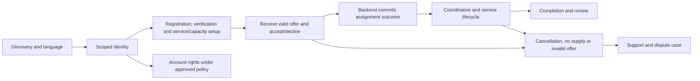
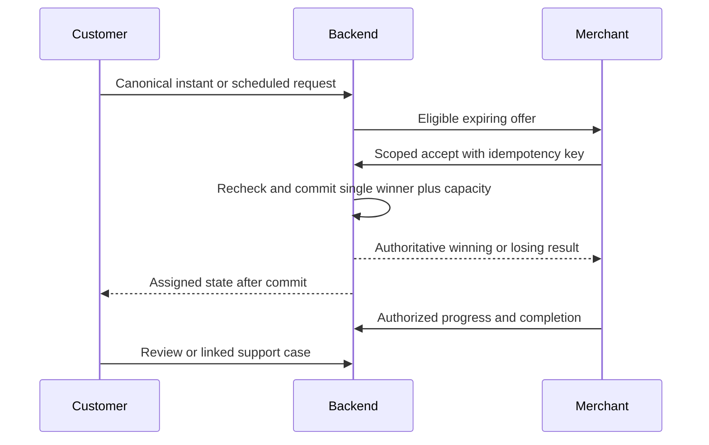
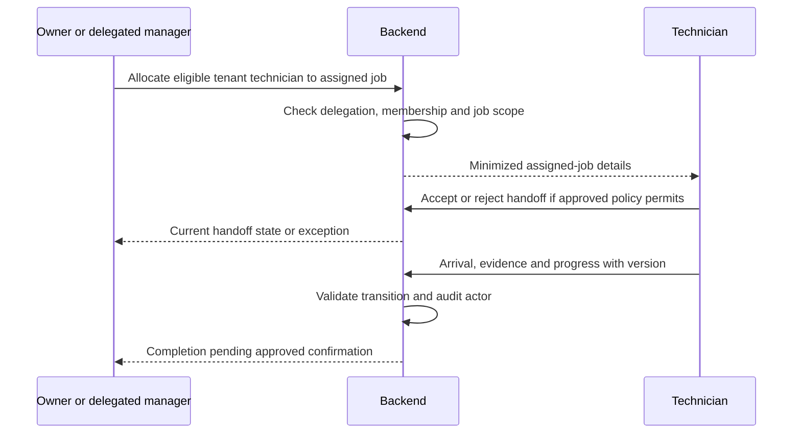

# Merchant owner and delegated manager journey

Status: CONCEPTUAL PHASE 00 BLUEPRINT, 2026-10-15. Interaction names are a proposed registry, not designed or implemented screens. Phase 02 owns business policy, Phase 04 detailed journeys and Phase 06 approved screen specifications.

## Channel and role contracts

| Channel | Entry and continuity | Interaction limits and recovery |
|---|---|---|
| Web/PWA | Public discovery; authenticated own-request or tenant workspace | Keyboard/focus and screen-reader feedback; show stale offline cache; reauthenticate before private writes. |
| Android | Authorized identity and request/offer deep links | Permission-denied location/photo alternatives; reconnect and reconcile canonical IDs. Push receipt is not acceptance. |
| iOS | Authorized identity and app/deep-link continuity | Platform permission/lifecycle handling, same backend state, restore pending action after interruption. |
| Official WhatsApp | Verified identity mapping and purpose/channel consent | Approved structured conversations/templates only; no invented repository/vendor access. Buttons/messages carry expiry and server checks; private evidence upload uses a approved scoped flow. |

Owner can delegate only approved merchant-scoped actions. A manager cannot decide verification, grant themselves privilege, see another tenant, or assume every owner action is delegated. The exact delegation and technician authentication policies remain OPEN.

## Stage reference

Each row contains the complete stage contract. Entry 'prior/current' means the preceding journey stage or an authorized deep link that first fetches current backend state. Shared accessibility/language duties apply at every listed interaction: visible labels, keyboard/focus order, screen-reader status/error text, non-color status cues, English/Telugu text reviewed by fluent speakers, local date/time ambiguity explained. Translation and accessibility tests are future evidence, not completed tests.

| Stage / objective | Entry | User action | System response | Backend responsibility | Status shown | Errors | Poor network/offline | Accessibility | English/Telugu | Required interaction | Traceability |
|---|---|---|---|---|---|---|---|---|---|---|---|
| MJ-01: Business discovery; Understand free participation | Public entry | Read eligibility and registration information | Show discovering and actionable next step | Show actual launch scope without fees or guaranteed demand | Discovering | Unsupported area | Show stale/pending; retry same command key and fetch current state | Labels, focus and announced status/errors | Persist chosen language; explain unavailable translations/timezone | MJ-01 conceptual screen or approved WhatsApp interaction | FR-M-001 |
| MJ-02: Free registration; Register without payment | Prior/current authorized stage | Submit registration | Show registered pending verification and actionable next step | Create canonical tenant-bound application idempotently | Registered pending verification | Duplicate business or invalid details | Show stale/pending; retry same command key and fetch current state | Labels, focus and announced status/errors | Persist chosen language; explain unavailable translations/timezone | MJ-02 conceptual screen or approved WhatsApp interaction | FR-M-001 |
| MJ-03: Account setup; Secure business access | Prior/current authorized stage | Authenticate owner account | Show authenticated and actionable next step | Bind membership/session to merchant tenant | Authenticated | Failed identity or expired session | Show stale/pending; retry same command key and fetch current state | Labels, focus and announced status/errors | Persist chosen language; explain unavailable translations/timezone | MJ-03 conceptual screen or approved WhatsApp interaction | NFR-SEC-001 |
| MJ-04: Business details; Describe business accurately | Prior/current authorized stage | Enter contact and business facts | Show draft saved and actionable next step | Validate ownership and separate public/private fields | Draft saved | Invalid field or unauthorized manager | Show stale/pending; retry same command key and fetch current state | Labels, focus and announced status/errors | Persist chosen language; explain unavailable translations/timezone | MJ-04 conceptual screen or approved WhatsApp interaction | FR-M-003 |
| MJ-05: Verification evidence; Supply safe review evidence | Prior/current authorized stage | Upload required approved evidence | Show submitted and actionable next step | Validate private upload and record case references | Submitted | Unsafe/incomplete upload | Show stale/pending; retry same command key and fetch current state | Labels, focus and announced status/errors | Persist chosen language; explain unavailable translations/timezone | MJ-05 conceptual screen or approved WhatsApp interaction | FR-M-002, NFR-SEC-002 |
| MJ-06: Review status; Know required next action | Prior/current authorized stage | View assigned case status | Show under review and actionable next step | Expose own status without reviewer/private case leakage | Under review | Case unavailable | Show stale/pending; retry same command key and fetch current state | Labels, focus and announced status/errors | Persist chosen language; explain unavailable translations/timezone | MJ-06 conceptual screen or approved WhatsApp interaction | FR-M-002 |
| MJ-07: Approval or rejection; Respond to review outcome | Prior/current authorized stage | Read reasons and resubmit if permitted | Show approved or rejected and actionable next step | Authorized reviewer writes auditable decision | Approved or rejected | Expired or revoked approval | Show stale/pending; retry same command key and fetch current state | Labels, focus and announced status/errors | Persist chosen language; explain unavailable translations/timezone | MJ-07 conceptual screen or approved WhatsApp interaction | FR-A-002 |
| MJ-08: Category selection; Offer eligible services | Prior/current authorized stage | Select approved categories | Show category enabled and actionable next step | Validate merchant eligibility and active taxonomy | Category enabled | Suspended merchant or invalid category | Show stale/pending; retry same command key and fetch current state | Labels, focus and announced status/errors | Persist chosen language; explain unavailable translations/timezone | MJ-08 conceptual screen or approved WhatsApp interaction | FR-M-003 |
| MJ-09: Service listing; Publish truthful service scope | Prior/current authorized stage | Create/update own listing | Show listed and actionable next step | Validate tenant and listing version | Listed | Conflict or unverified claims | Show stale/pending; retry same command key and fetch current state | Labels, focus and announced status/errors | Persist chosen language; explain unavailable translations/timezone | MJ-09 conceptual screen or approved WhatsApp interaction | FR-M-003, FR-X-003 |
| MJ-10: Coverage zones; Limit offered geography | Prior/current authorized stage | Set permitted service areas | Show coverage set and actionable next step | Validate configured city/zone coverage | Coverage set | Unknown/outside zone | Show stale/pending; retry same command key and fetch current state | Labels, focus and announced status/errors | Persist chosen language; explain unavailable translations/timezone | MJ-10 conceptual screen or approved WhatsApp interaction | FR-M-003, NFR-SCALE-001 |
| MJ-11: Pricing disclosure; Show permitted verified prices | Prior/current authorized stage | Enter applicable verified terms | Show price visible or unavailable and actionable next step | Apply approved pricing policy without guarantees | Price visible or unavailable | Missing policy or unreliable value | Show stale/pending; retry same command key and fetch current state | Labels, focus and announced status/errors | Persist chosen language; explain unavailable translations/timezone | MJ-11 conceptual screen or approved WhatsApp interaction | FR-M-003, FR-X-005 |
| MJ-12: Business hours; Set realistic operating times | Prior/current authorized stage | Update local hours | Show hours recorded and actionable next step | Validate timezone and dispatch eligibility | Hours recorded | Invalid times or schedule overlap | Show stale/pending; retry same command key and fetch current state | Labels, focus and announced status/errors | Persist chosen language; explain unavailable translations/timezone | MJ-12 conceptual screen or approved WhatsApp interaction | FR-M-003 |
| MJ-13: Staff and technicians; Delegate safely | Prior/current authorized stage | Add permitted tenant members and technician assignments | Show staff active or revoked and actionable next step | Check grants, delegation scope and revocation | Staff active or revoked | Unauthorized/self-elevating grant | Show stale/pending; retry same command key and fetch current state | Labels, focus and announced status/errors | Persist chosen language; explain unavailable translations/timezone | MJ-13 conceptual screen or approved WhatsApp interaction | FR-M-007, NFR-SEC-001 |
| MJ-14: Available capacity; Avoid overbooking | Prior/current authorized stage | Set actual reservable capacity | Show capacity available or full and actionable next step | Validate units/windows; use committed reservations | Capacity available or full | Concurrent update/reservation conflict | Show stale/pending; retry same command key and fetch current state | Labels, focus and announced status/errors | Persist chosen language; explain unavailable translations/timezone | MJ-14 conceptual screen or approved WhatsApp interaction | FR-X-002, NFR-SEC-003 |
| MJ-15: Online or offline; Signal actual availability | Prior/current authorized stage | Toggle availability | Show available or unavailable and actionable next step | Store versioned declaration; recheck hours and capacity | Available or unavailable | Stale status/closed hours | Show stale/pending; retry same command key and fetch current state | Labels, focus and announced status/errors | Persist chosen language; explain unavailable translations/timezone | MJ-15 conceptual screen or approved WhatsApp interaction | FR-M-003 |
| MJ-16: Eligible notification; Receive potential work | Prior/current authorized stage | Open offer notification | Show offered and actionable next step | Deliver only scoped current eligible offers | Offered | Failed, stale or opt-out delivery | Show stale/pending; retry same command key and fetch current state | Labels, focus and announced status/errors | Persist chosen language; explain unavailable translations/timezone | MJ-16 conceptual screen or approved WhatsApp interaction | FR-M-004, FR-M-008 |
| MJ-17: Viewing request; Understand allowed job details | Prior/current authorized stage | Open offer with authenticated scope | Show offer valid or expired and actionable next step | Return minimized current offer, generation and expiry | Offer valid or expired | Private data denied or revoked offer | Show stale/pending; retry same command key and fetch current state | Labels, focus and announced status/errors | Persist chosen language; explain unavailable translations/timezone | MJ-17 conceptual screen or approved WhatsApp interaction | FR-M-004, NFR-SEC-002 |
| MJ-18: Accept or decline; Respond once | Prior/current authorized stage | Send accept/decline with idempotency key | Show response pending and actionable next step | Recheck tenant, offer, expiry, verification and capacity | Response pending | Duplicate, expired or revoked approval | Show stale/pending; retry same command key and fetch current state | Labels, focus and announced status/errors | Persist chosen language; explain unavailable translations/timezone | MJ-18 conceptual screen or approved WhatsApp interaction | FR-M-005 |
| MJ-19: Winning or losing; Know definitive outcome | Prior/current authorized stage | Read committed backend receipt | Show won or lost and actionable next step | Serialize contenders, reserve one capacity and persist result | Won or lost | Lost response, race or full capacity | Show stale/pending; retry same command key and fetch current state | Labels, focus and announced status/errors | Persist chosen language; explain unavailable translations/timezone | MJ-19 conceptual screen or approved WhatsApp interaction | FR-M-006, NFR-SEC-003 |
| MJ-20: Job assignment; Manage actual winning work | Prior/current authorized stage | Open confirmed assigned job | Show assigned and actionable next step | Authorize tenant to current assignment | Assigned | Wrong tenant or superseded generation | Show stale/pending; retry same command key and fetch current state | Labels, focus and announced status/errors | Persist chosen language; explain unavailable translations/timezone | MJ-20 conceptual screen or approved WhatsApp interaction | FR-M-007 |
| MJ-21: Technician allocation; Allocate permitted technician | Prior/current authorized stage | Select eligible staff and handoff | Show coordinating and actionable next step | Check tenant/job capacity and approved delegation | Coordinating | Busy technician or revoked membership | Show stale/pending; retry same command key and fetch current state | Labels, focus and announced status/errors | Persist chosen language; explain unavailable translations/timezone | MJ-21 conceptual screen or approved WhatsApp interaction | FR-M-007 |
| MJ-22: Customer coordination; Coordinate within privacy policy | Prior/current authorized stage | Use approved contact channel | Show coordinating and actionable next step | Scope contact disclosure and audit relevant actions | Coordinating | Consent/permission restriction | Show stale/pending; retry same command key and fetch current state | Labels, focus and announced status/errors | Persist chosen language; explain unavailable translations/timezone | MJ-22 conceptual screen or approved WhatsApp interaction | NFR-SEC-002, FR-M-007 |
| MJ-23: Arrival and service updates; Report truthful progress | Prior/current authorized stage | Submit assigned-job updates | Show arrived or in progress and actionable next step | Validate actor, state and expected version | Arrived or in progress | Offline duplicate or illegal transition | Show stale/pending; retry same command key and fetch current state | Labels, focus and announced status/errors | Persist chosen language; explain unavailable translations/timezone | MJ-23 conceptual screen or approved WhatsApp interaction | FR-M-007, FR-X-003 |
| MJ-24: Completion; Record work outcome | Prior/current authorized stage | Submit completion/evidence | Show completion pending or completed and actionable next step | Store permitted completion pending confirmation rule | Completion pending or completed | Customer dispute or unsafe upload | Show stale/pending; retry same command key and fetch current state | Labels, focus and announced status/errors | Persist chosen language; explain unavailable translations/timezone | MJ-24 conceptual screen or approved WhatsApp interaction | FR-M-007 |
| MJ-25: Cancellation or no-show; Handle inability safely | Prior/current authorized stage | Report reason and request permitted cancellation | Show cancelled or exception and actionable next step | Preserve history, release capacity and govern reassignment | Cancelled or exception | Conflicting acceptance or no-show claim | Show stale/pending; retry same command key and fetch current state | Labels, focus and announced status/errors | Persist chosen language; explain unavailable translations/timezone | MJ-25 conceptual screen or approved WhatsApp interaction | FR-M-007, NFR-REL-001 |
| MJ-26: Reviews and reputation; See genuine feedback | Prior/current authorized stage | Read eligible reviews/respond under policy | Show published or under review and actionable next step | Link actual job and apply moderation rules | Published or under review | Abusive/false claim | Show stale/pending; retry same command key and fetch current state | Labels, focus and announced status/errors | Persist chosen language; explain unavailable translations/timezone | MJ-26 conceptual screen or approved WhatsApp interaction | FR-M-007, FR-X-003 |
| MJ-27: Support and disputes; Resolve service concerns | Prior/current authorized stage | Open scoped case and submit evidence | Show investigating and actionable next step | Assign conflict-free handler and audit disposition | Investigating | Outside-case access or unavailable support | Show stale/pending; retry same command key and fetch current state | Labels, focus and announced status/errors | Persist chosen language; explain unavailable translations/timezone | MJ-27 conceptual screen or approved WhatsApp interaction | FR-A-004, NFR-OPS-001 |
| MJ-28: Authorized analytics; Understand own performance | Prior/current authorized stage | Open tenant-scoped metrics | Show report current or stale and actionable next step | Apply grants and disclose definitions/freshness | Report current or stale | Unauthorized export or absent metric | Show stale/pending; retry same command key and fetch current state | Labels, focus and announced status/errors | Persist chosen language; explain unavailable translations/timezone | MJ-28 conceptual screen or approved WhatsApp interaction | FR-A-006, NFR-OBS-001 |
| MJ-29: Suspension and reverification; Restore permitted eligibility | Prior/current authorized stage | Read reasons and resubmit evidence | Show suspended or under review and actionable next step | Enforce suspended state; protect active-job safety handling | Suspended or under review | Revoked verification while offer active | Show stale/pending; retry same command key and fetch current state | Labels, focus and announced status/errors | Persist chosen language; explain unavailable translations/timezone | MJ-29 conceptual screen or approved WhatsApp interaction | FR-A-002, FR-M-002 |
| MJ-30: Account and data rights; Manage permitted business data | Prior/current authorized stage | Request access/export/deletion | Show rights request pending and actionable next step | Verify authority and lawful retention; prevent cross-tenant export | Rights request pending | Unverified request or legal hold | Show stale/pending; retry same command key and fetch current state | Labels, focus and announced status/errors | Persist chosen language; explain unavailable translations/timezone | MJ-30 conceptual screen or approved WhatsApp interaction | NFR-SEC-002, NFR-BCP-001 |

## Journey diagram

The drawing groups the detailed stages above. A user can enter through a deep link but still crosses scoped authentication and current-state checks. Exceptions route to support without losing request history. Privacy actions are account workflows, not automatic deletion of audit/booking records.

## Customer, backend and merchant sequence

Backend commit decides the winner; channel delivery can fail or arrive late. Both parties read fresh scoped state after reconnect. No quote, payment, guarantee or arrival time is manufactured.

## Merchant and technician handoff sequence

The handoff is separate from merchant dispatch acceptance. A technician rejection cannot give a second merchant the same active assignment; it invokes coordination/exception policy. Customer contact and photos remain job-scoped.

## Error, privacy and implementation responsibilities

Expired offers, revoked verification, capacity conflicts, duplicate actions, lost connectivity and failed delivery always reconcile against backend state. A stale message cannot advance a terminal booking. Quotes/inspection charges, cancellation cutoffs, support SLA, account retention and reviews policy remain OPEN. NFR-UX-001/002 apply across every stage. Detailed channel parity and interaction approval belongs to Phase 04; tests run in Phases 12–18. See [flows](../flows/state-machines.md), [channel continuity](../flows/cross-channel-continuity.md), [traceability](../blueprint/traceability-matrix.md) and [blueprint guide](../blueprint/README.md).
