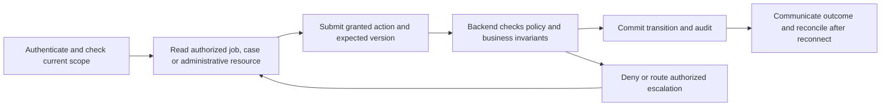

# operations journey

Status: CONCEPTUAL PHASE 00 BLUEPRINT, 2026-10-15. These are proposed interactions, not existing pages. Phase 04 specifies journeys; Phase 06 approves screens; Phases 10–17 implement authorization and operational evidence.

## Role, entry and channel

Private staff web is the primary conceptual entry. Public customer or merchant sessions cannot access staff pages. MFA, assigned operational/case scope and approved grants apply. Every interaction checks current role, resource scope and version. Owner/manager permissions do not imply staff authority.

## Journey stage contracts

| Stage | User action | Permission | Backend responsibility | Audit record | Error/denial state |
|---|---|---|---|---|---|
| 01 Privileged entry | Authenticate with required MFA and case scope | Assigned operational role | Verify staff grant/session and prevent self-elevation | Login/denial/grant context | Expired session or revoked access |
| 02 Monitoring and queues | Inspect current requests and case queues | Approved operational region/case scope | Return timestamps/freshness; mask private evidence | Access, query scope and correlation | Stale dashboard or denied region |
| 03 Dispatch exceptions | Investigate timeout/no-supply/capacity incidents | Read scoped dispatch; overrides only under separate policy | Reconcile assignment generation and capacity; never direct-row edit | Actor, evidence, reason and commands | Conflicting winner, stale version or unapproved override |
| 04 Support and disputes | Triage, assign and investigate linked cases | Case-scoped handler authority | Minimize evidence; prevent reviewer conflicts; preserve history | Classification, assignment and disposition | Unsafe evidence, conflict of interest or missing authority |
| 05 Safety and escalation | Escalate customer safety, fraud or technical failure | Approved escalation and incident grants | Record accountable lead; use verified guidance, not invented SLA | Severity basis, actions and escalation | Unavailable staff route or unclear legal power |
| 06 Incident recovery | Run authorized mitigation and confirm recovery | Runbook-scoped machine/staff authority | Reconcile retries/outbox and business invariants before status | Mitigation, validation and rollback record | Provider outage, replay backlog or incorrect reservation |
| 07 Case closure and review | Communicate permitted resolution and follow-ups | Assigned case and lawful retention policy | Append corrections, publish approved outcome, retain audit | Final reason, accepted evidence and reopen route | Disputed disposition or retention restriction |

## Journey diagram

The drawing explains the common responsibility sequence for every row: permission is checked before reading and again before acting. Audit evidence records denied and successful privileged actions under approved redaction/retention policy. Escalation does not manufacture greater privileges.

## Connectivity, accessibility and language

Disconnected clients show last-seen state and unconfirmed actions as pending. Retry with the same actor/operation key, then fetch authoritative outcome; do not repeat a privileged command with a new key after an ambiguous response. English/Telugu content needs reviewed labels, reason/error text and consistent dates. Keyboard navigation, clear focus, announced status and non-color error cues are required. No actual accessibility or user tests were run. A failed notification never expands access or automatically completes work.

## Decisions, safety and traceability

Handoff, customer contact masking, staff support hours, escalation, dual control, emergency expiry, evidence retention and customer safety instructions remain OPEN. All screenshots/UI designs, runbooks, MFA recovery proofs and incident drills are future deliverables. FR-A-001/002/003/004/005/006, NFR-SEC-001/002, NFR-OBS-001 and NFR-OPS-001 apply. See [access matrix](../security/access-control.md), [authentication](../flows/authentication-authorization.md), [support](../flows/support-disputes.md), [operations flow](../flows/operations-incidents.md) and [traceability](../blueprint/traceability-matrix.md).
