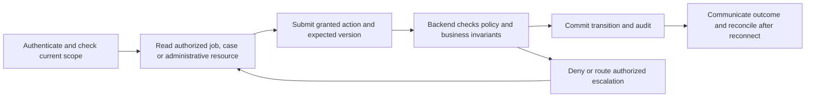

# super admin journey

Status: CONCEPTUAL PHASE 00 BLUEPRINT, 2026-10-15. These are proposed interactions, not existing pages. Phase 04 specifies journeys; Phase 06 approves screens; Phases 10–17 implement authorization and operational evidence.

## Role, entry and channel

Private staff web is the primary conceptual entry. Public customer or merchant sessions cannot access staff pages. MFA, assigned operational/case scope and approved grants apply. Every interaction checks current role, resource scope and version. Owner/manager permissions do not imply staff authority.

## Journey stage contracts

| Stage | User action | Permission | Backend responsibility | Audit record | Error/denial state |
|---|---|---|---|---|---|
| 01 Privileged authentication | Use MFA and governed session recovery | Named privileged grant; no self-grant | Check identity/session, separation of duties and reauthentication | Login and denial events | Failed factor, revoked grant or unsafe recovery |
| 02 Dashboard | Inspect current platform summary | Approved administrative read scope | Return redacted metrics and freshness | Actor, scoped access | Missing metric or stale projection |
| 03 Customers | Govern account/support actions | Explicit customer-resource permission | Minimize private data; validate reason and lawful action | Actor, subject, reason, outcome | Unapproved deletion, impersonation or access |
| 04 Merchant verification and suspension | Approve governed review or suspension | Reviewer/admin evidence grant | Apply verification state, conflict controls and active-job safety handling | Case/evidence reference and decision | Missing evidence, appeal or revocation race |
| 05 Categories | Manage approved taxonomy | Catalog configuration grant | Version changes and avoid breaking current service references | Actor, prior/new versions | Unapproved category or impacted active offers |
| 06 Regions and service zones | Govern allowed geography | Region/zone grant | Apply evidence-gated expansion; validate boundary overlap | Scope and configuration versions | Unapproved city expansion or ambiguous zone |
| 07 Staff roles and permissions | Grant/revoke approved capabilities | Governed grant with separation of duties | Reject self-elevation and tenant-crossing delegation | Grant target, reason and reviewer | Privilege escalation or stale grant |
| 08 Dispatch controls | Review configuration and allowed overrides | Explicit high-risk command grant | Preserve one winner/capacity invariant; no direct patching | Command, versions and exception evidence | Acceptance race or unapproved emergency policy |
| 09 Notification configuration | Govern approved channels/templates | Notification policy grant | Check consent, expiry, credential boundaries and versioning | Configuration change and effect | Vendor permission absent or opt-out violation |
| 10 Support and disputes | Escalate appropriately scoped cases | Case authority and conflict checks | Approve only permitted disposition; no invented compensation | Case, reason and evidence | Missing policy or conflicted handler |
| 11 Abuse and fraud | Review substantiated signals | Sensitive investigation grant | Separate allegations from verified facts and restrict exposure | Signal provenance and action basis | False positive or excessive data access |
| 12 Audit logs | Inspect protected history | Read/export grant and retention policy | Append-only correction; redact exports; prohibit routine deletion | Access/export and correction linkage | Unsafe export or attempted mutation |
| 13 Metrics and reports | Read authorized analytics | Metric/data-scope grant | Expose definitions, time basis and incomplete data | Query and scope | Misleading aggregation or cross-tenant leak |
| 14 Costs and health | Review verified spending and service signals | Cost/system read grant | Show measured data and uncertainty, not fabricated totals | Source/time and access | Missing vendor data or stale monitor |
| 15 Security incidents | Lead authorized incident response | Security response grant | Triage, contain through approved runbooks, preserve evidence | Incident actions and response approvals | Unavailable authority or unsafe mitigation |
| 16 Emergency actions | Invoke separately approved break-glass workflow | Time-bounded, audited, independently governed authority | Require approved reason/dual control/review policy; no assumed bypass | Actor, approver, expiry, action and review | No policy, self-approval or violated business invariant |

## Journey diagram

The drawing explains the common responsibility sequence for every row: permission is checked before reading and again before acting. Audit evidence records denied and successful privileged actions under approved redaction/retention policy. Escalation does not manufacture greater privileges.

## Connectivity, accessibility and language

Disconnected clients show last-seen state and unconfirmed actions as pending. Retry with the same actor/operation key, then fetch authoritative outcome; do not repeat a privileged command with a new key after an ambiguous response. English/Telugu content needs reviewed labels, reason/error text and consistent dates. Keyboard navigation, clear focus, announced status and non-color error cues are required. No actual accessibility or user tests were run. A failed notification never expands access or automatically completes work.

## Decisions, safety and traceability

Handoff, customer contact masking, staff support hours, escalation, dual control, emergency expiry, evidence retention and customer safety instructions remain OPEN. All screenshots/UI designs, runbooks, MFA recovery proofs and incident drills are future deliverables. FR-A-001/002/003/004/005/006, NFR-SEC-001/002, NFR-OBS-001 and NFR-OPS-001 apply. See [access matrix](../security/access-control.md), [authentication](../flows/flow-09-authentication.md), [support](../flows/flow-10-support.md), [operations flow](../flows/flow-11-operations.md) and [traceability](../blueprint/traceability-matrix.md).
