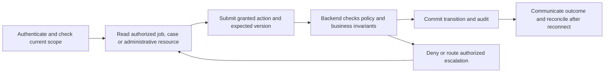

# technician journey

Status: CONCEPTUAL PHASE 00 BLUEPRINT, 2026-10-15. These are proposed interactions, not existing pages. Phase 04 specifies journeys; Phase 06 approves screens; Phases 10–17 implement authorization and operational evidence.

## Role, entry and channel

Technicians receive only assigned-job access under their merchant tenant; independent technician login and handoff policy remain OPEN. Mobile/web capability is a proposed staff surface, not an extra approved customer/merchant product. Every interaction checks current role, resource scope and version. Owner/manager permissions do not imply staff authority.

## Journey stage contracts

| Stage | User action | Permission | Backend responsibility | Audit record | Error/denial state |
|---|---|---|---|---|---|
| 01 Assigned-job entry | Authenticate and open assigned work | Assigned tenant/job only | Verify current membership/assignment; mask contact/photo fields | Actor, job, access decision | Revoked membership, wrong tenant or superseded assignment |
| 02 Handoff response | Accept/reject handoff only if policy permits | Assigned-job action with approved handoff grant | Record handoff without changing merchant winner; route rejection to coordinator | Actor, reason, version, outcome | Expired handoff or duplicate response |
| 03 Travel and arrival | Report truthful travel/arrival | Current assigned job only | Validate lifecycle transition; no fabricated ETA | Timestamp, transition, version | Offline pending status or illegal state |
| 04 Execution and evidence | Perform agreed work and upload permitted evidence | Job-specific upload/update grant | Validate upload type/privacy and approved customer terms | Evidence reference, actor, action | Unsafe upload, denied contact or disputed quote |
| 05 Customer coordination | Use approved job contact route | Minimum fields under current assignment | Enforce purpose/access and consent limitations | Relevant contact access event | Wrong contact, opt-out or unsafe situation |
| 06 Completion and exception | Report work completion or safety/no-show issue | Assigned-job completion/report grant | Store completion pending approved confirmation; open exception/case | Actor, reason, result | Lost response, duplicate submission or disputed completion |

## Journey diagram

The drawing explains the common responsibility sequence for every row: permission is checked before reading and again before acting. Audit evidence records denied and successful privileged actions under approved redaction/retention policy. Escalation does not manufacture greater privileges.

## Connectivity, accessibility and language

Disconnected clients show last-seen state and unconfirmed actions as pending. Retry with the same actor/operation key, then fetch authoritative outcome; do not repeat a privileged command with a new key after an ambiguous response. English/Telugu content needs reviewed labels, reason/error text and consistent dates. Keyboard navigation, clear focus, announced status and non-color error cues are required. No actual accessibility or user tests were run. A failed notification never expands access or automatically completes work.

## Decisions, safety and traceability

Handoff, customer contact masking, staff support hours, escalation, dual control, emergency expiry, evidence retention and customer safety instructions remain OPEN. All screenshots/UI designs, runbooks, MFA recovery proofs and incident drills are future deliverables. FR-M-007, FR-C-005, NFR-SEC-001/002 and NFR-OPS-001 apply. See [access matrix](../security/access-control.md), [authentication](../flows/flow-09-authentication.md), [support](../flows/flow-10-support.md), [operations flow](../flows/flow-11-operations.md) and [traceability](../blueprint/traceability-matrix.md).
