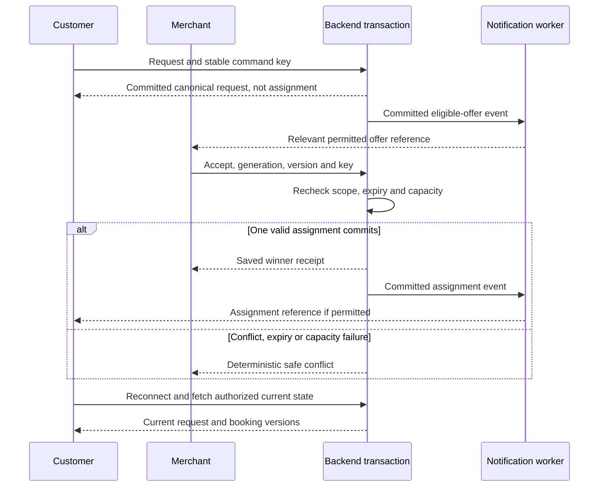
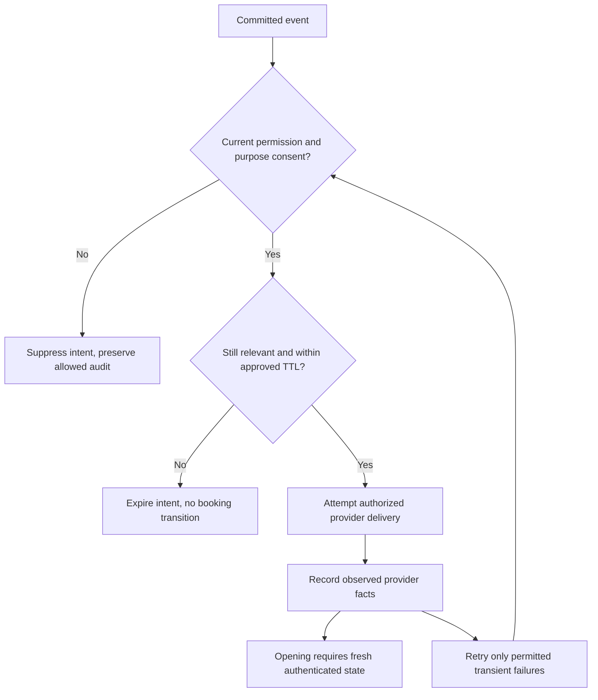

# Phase 04 behaviour and cross-channel specification candidates

2026-10-15. **DRAFT PREPARATION — NOT FINAL JOURNEY, SCREEN OR PHASE APPROVAL.** [Work authority](../../governance/phase-01-05-work-authorization.md) permits preparation while prior exits remain open. Source: [Phase 04 dossier](../phase-04.md), existing [state machines](../../flows/state-machines.md), [continuity](../../flows/cross-channel-continuity.md), [requirements draft](../phase-02-preparation/requirements-draft.md), [architecture candidates](../phase-03-preparation/architecture-contracts.md). These candidates do not alter the approved roadmap or any Phase 00 blueprint bytes.

## Catalogues, identity and default denial

The [interaction catalogue](interaction-catalogue.json) maps all 83 existing stages: customer CJ-01–24, merchant MJ-01–30, technician stages 01–06, operations stages 01–07 and Super Admin stages 01–16. New P04-I identifiers are cross-reference keys, not renamed requirements or approved screens. Source-stage actions and permissions remain authoritative conceptual intent; each entry inherits the six outcome classes below through its primary flow. Additional linked flow dependencies still apply (for example privacy needs authentication and case authorization).

The [state catalogue](state-catalogue.json) refines all 45 conceptual edges and identifies 11 proposed additions separately. The additions repair draft coverage for pre-search/no-supply cancellation, governed reassignment and booking safety/exception paths. They require owner/policy review and are not silently adopted into the approved conceptual sources. Every listed edge also requires the shared authorization/version/idempotency/policy guards. An unapproved underlying policy keeps the candidate transition disabled.

The quoted-work edge keeps the conceptual `QuotePending → InProgress` pair but refines its trigger for policy review: customer consent is a separately audited exact-version field command while the booking remains QuotePending; actual work begins only when the assigned authorized technician reports start referencing that consent. `quote.consented` and `booking.started` are separate events. Approval of a quote must not display work as already started. The Phase 00 source remains unchanged; this refinement is not an approved policy amendment.

For each machine, every state pair not listed is forbidden, including arbitrary same-state mutation. Replaying a previously committed command receipt does not execute another transition. Price/contact/configuration edits and quote revisions use separately authorized field commands; they are not generic state-machine self-loops. Do not infer access merely because a button exists, a notification was delivered or a user is logged in.

Creation is a separate authorized command establishing the initial state: Verification Draft, Request Created, Offer Created, transaction-internal Assignment Reserved, Booking Assigned, Support Open. Canonical creation is payload-bound and idempotent; customer requests do not create merchant verification cases or privileged assignments. Initial states are not proof that subsequent policy conditions are met.

## State ownership and version contracts

| Aggregate / owner | Authority and version | Forbidden shortcut / recovery |
|---|---|---|
| Verification / Verification | Reviewer decision version, evidence/task scope and validity; merchant only submits | Self-approval, rating/acquaintance-based verification and notification-based reinstatement denied; reasoned resubmission is explicit |
| Request / Request | Canonical customer ID, mode, generation and request version | No second logical request after channel retry; authorized retry/reassignment creates new generation, never revives old offers |
| Offer / Dispatch | Request generation, offer version/expiry and eligibility versions | Declined/expired/lost/invalidated cannot win; client clock and delivery order have no authority |
| Assignment / Dispatch | One live winner and resource reservation across request generations | Reserved is internal until transaction commits; released/completed record cannot be reactivated to manufacture another live assignment |
| Booking / Booking | Job version, current assignment/generation and exact quote/consent version | Provider reports do not imply customer agreement; no unapproved automatic completion from silence |
| Support / Support | Assigned case scope, case version, evidence/disposition and escalation owner | Allegation is not established misconduct; no compensation promise or evidence erasure from closure |

Request generation fences all offers/assignments for a search cycle. Each aggregate has its own version: a quote change is not identified only by request version; acceptance checks request generation/version plus offer/current eligibility. Customer-facing effective status composes request and booking state rather than pretending Request Assigned is a terminal completion status. Expose distinct `requestState`, `bookingState`, generation, corresponding versions and freshness; a Booking Completed can coexist with historical Request Assigned without requesting another transition. Reassignment archives/releases the prior live assignment before a new search generation becomes actionable.

## Channel and role contract

| Role | Website/PWA | Android / iOS | Official WhatsApp | Backend notification / support |
|---|---|---|---|---|
| Customer | Public discovery; private own-request actions after authentication | Same canonical commands; location/photo permission alternatives and lifecycle recovery | Approved linked identity, opt-in/window/template-constrained request/status/quote actions; sensitive data requires secure authorized view | Minimal payload, secure current-state view, own case and purpose-specific delivery permission |
| Merchant | Own-business registration, evidence, catalog, staff/capacity and job actions | Same granted business/job commands, not guaranteed background execution | Candidate scoped offers/accept/decline/status only after actual provider approval; evidence/configuration uses secure forms | Notification is not assignment; tenant membership and fresh offer required on opening |
| Technician | Independently authenticated assigned-job subset | Same job grant, permission-aware evidence/arrival and reconnect | NOT an approved technician command surface; no role inferred from a forwarded merchant message | Approved channel/handoff reference only; no exact address/photo on lock-screen payload |
| Operations | Private staff web, MFA, region/case/runbook grants | No staff mobile app scope inferred from customer/merchant app objectives | No privileged operations command via WhatsApp in this candidate | Case-scoped private web and approved incident escalation; no public complaint narrative |
| Super Admin | Private staff web; explicit action grants, MFA, audit and reason | No privileged app scope inferred | No admin grant from phone ownership, chat command or template | Security/incident alerts are references only; no credential, break-glass or self-grant by notification |

Parity means equivalent backend permissions/outcomes where an interaction is supported, not every feature on every channel. Unavailable/unsupported paths show a truthful limitation and approved secure entry route; they do not weaken auth or launch objectives. Web/PWA, official WhatsApp and required customer/merchant store apps remain the coordinated-release objectives. This preparation neither removes channels nor claims store/provider readiness.

Entry guards are stage-specific: public merchant discovery needs no membership; free registration accepts an authenticated applicant with representative authority and creates pending business scope rather than requiring an existing tenant. Enrollment/authentication itself must be reachable before private grants exist. Technician authentication can begin before a job is authorized, but the resulting job view still requires current active membership and assignment. Pending applicants may submit/view their own intake evidence; neither intake nor founder acquaintance grants service eligibility.

## Major-flow outcome and recovery matrix

Each FLOW row inherits source-specific actions and all common guards; success/failure/timeout/cancellation/unauthorized/recovery are acceptance scenarios to execute later, not passed tests. In pre-booking identity/verification/privacy flows, “cancellation” means abandon or withdraw the workflow under policy, not cancel unrelated bookings or erase required audit. No generic timeout creates consent, fees, refunds, completion or a second winner.

| Flow / source | Success | Failure | Timeout | Cancellation | Unauthorized | Recovery |
|---|---|---|---|---|---|---|
| FLOW-01 [discovery](../../flows/flow-01-discovery.md) | Truthful eligible result with configured category/zone/freshness | Unknown location, no safe supply or stale data is explicit | Slow search shows retry, never fabricated providers | Abandon search without request/fee | Private merchant evidence and other customer details denied | Retry/refine address; recheck fresh eligibility before any offer |
| FLOW-02 [request](../../flows/flow-02-request.md) | One canonical instant/scheduled request receipt after commit | Invalid details/unsafe photo/unsupported slot reject with accessible field guidance | Ambiguous response stays pending, not assigned | Serialized permitted cancellation using current generation/version | Anonymous creation or foreign request mutation denied | Same actor/key/payload reconciles; changed payload requires deliberate new action |
| FLOW-03 [eligibility](../../flows/flow-03-eligibility.md) | Candidate set uses approved category, zone, verification, hours and reservable resource | Empty set, unavailable resource, alias/shared staff or revoked scope excludes offer | Search exhausted is factual; no arrival promise | Stop current generation and invalidate actionable offers atomically | Wrong tenant/region or unauthorized config edits denied | Approved retry creates fresh generation and eligibility snapshot; no cached capacity decision |
| FLOW-04 [acceptance](../../flows/flow-04-atomic-acceptance.md) | First valid committed winner and reservation; loser outcomes deterministic | Expired/revoked/stale/over-capacity/key conflict yields no extra reservation | Lost receipt remains pending until same-key reconciliation | Cancel/accept serialize; whichever valid transaction commits governs permitted later action | Forwarded offer, wrong tenant or technician without merchant grant denied | Read committed current assignment; never retry under another key to steal a winner |
| FLOW-05 [lifecycle](../../flows/flow-05-lifecycle.md) | Scoped handoff, factual arrival, quote consent, progress, completion pending and approved outcome | Busy technician, unsafe evidence, disputed terms or illegal transition routes exception | Silent technician/customer does not imply arrival, quote consent or completion | Approved stage-specific termination; in-progress safety policy first, no unapproved charge | Unassigned technician, foreign job, stale quote or role impersonation denied | Reauthenticate/reconcile state, handle exception with current consent and correct reservation |
| FLOW-06 [cancellation](../../flows/flow-06-cancellation.md) | Reasoned permitted cancellation releases correct capacity once | Unsafe stage/cutoff or version conflict explains factual status | Ambiguous result uses same key; no repeated release or automatic reassignment | Withdrawal of an uncommitted cancel must not reactivate an already cancelled job | Other customer's cancel or ordinary ops winner override denied | Only approved consented reassignment releases old assignment before new generation |
| FLOW-07 [verification](../../flows/flow-07-verification.md) | Conflict-free reviewer decides lawful task scope with reasons | Missing/unsafe evidence remains pending/rejected, never auto-approved | Delay is pending with actual support limitation, no promised SLA | Applicant may withdraw under approved retention/active-work policy; no audit erasure | Self-approval, unassigned evidence view and suspended offers denied | Reasoned resubmission/reverification; no blind restoration of eligibility |
| FLOW-08 [notifications](../../flows/flow-08-notifications.md) | Committed event leads to permitted relevant delivery attempt | Provider failure/opt-out/stale event yields failed/suppressed status, not a booking change | Bounded retry/TTL; unknown delivery is unknown, not accepted | Cancel pending obsolete sends where possible; cannot recall already delivered messages | Forged callback, foreign token or revoked recipient access denied | Fetch latest authorized state; dedupe event, retain delivery facts, staffed backlog route |
| FLOW-09 [identity](../../flows/flow-09-authentication.md) | Current scoped session and explicit linked identity | Failed factor, expired invite/session or unsafe recovery denies | Reauthentication required; offline cache never extends privilege | Abandon auth/linking; explicit unlink/revoke does not destroy booking history | Phone possession, copied link, shared owner login and self-elevation denied | Approved recovery with current ownership/MFA evidence; reconcile pending commands after auth |
| FLOW-10 [support](../../flows/flow-10-support.md) | Own linked case, assigned handler and evidenced permitted resolution | Unstaffed route, unsafe evidence or conflict of interest disclosed and escalated | Preserve case and accountable route; do not invent response/deadline compliance | Withdraw complaint under policy without suppressing safety evidence or others' rights | Outside-case access, unilateral refund/guarantee or hidden review deletion denied | Reopen/appeal under policy; retain old disposition and negative findings |
| FLOW-11 [operations](../../flows/flow-11-operations.md) | Scoped triage, safe authorized mitigation and measured reconciliation | Unknown authority/runbook or unsafe action stops affected operation | Escalate through actual staffing; no made-up 24/7 coverage | Abort uncommitted mitigation; rollback only where safe, retain incident | Direct row patches, self-grant, cross-region access or assumed break-glass denied | Validate one winner/capacity/outbox invariants before declaring recovery; record evidence |
| FLOW-12 [privacy](../../flows/flow-12-privacy.md) | Own authenticated case with lawful export/delete disposition | Identity mismatch, legal hold or unsupported scope explained without leaking third-party data | Receipt is pending; no fabricated deletion or legal clearance | Withdrawal/consent revocation handled prospectively with lawful retention, not silent booking cancellation | Foreign export, broad ops access or token-only identity denied | Secure identity route, hold-aware processing, deletion tombstones and backup reconciliation |

## Races, availability and service safety

Customer cancellation, acceptance, expiry, suspension and generation replacement must share the [Phase 03 transaction discipline](../phase-03-preparation/architecture-contracts.md). A queue callback cannot select a different winner. Authorization/revocation races must be reviewed over all eligibility records, not inferred from the [partial 12-session proof](../phase-03-preparation/proof-review.md). A suspended merchant's active work gets a governed safety case; do not silently erase the job or advertise continued eligibility.

Scheduled Requested is not Reserved or Confirmed. Capture requested window/timezone, clearly identify unconfirmed provider status, and apply an approved activation or advance-acceptance policy before reserving shared resource intervals. Store travel buffers/interval semantics only after policy approval; no headcount-based double allocation across merchant aliases. Customer request changes require fresh terms/version and capacity validation. Delayed worker activation does not backdate service availability.

Technician handoff is distinct from merchant offer acceptance. A handoff rejection reports a coordination exception, not a transfer to a competing merchant. A no-show is a report until assessed, not an automatic fraud fact or fine. Arrival is a reported event, not inferred from a stale location. Quote changes invalidate prior-version consent; offline approval of an old quote cannot start work. Work completion is reported separately from customer-confirmed/approved completion. No timeout or silence confirms a disputed job unless an explicit lawful policy is later approved.

## Offline, reconnect and account continuity

Each pending local action retains its actor, operation, key, payload digest and expected aggregate version. Reconnect first checks current authentication/resource scope, then queries saved outcome/snapshot; lost/expired cursor falls back to bounded current snapshot. Replayed events are filtered by current recipient rights, not historic access. Losing/expired offer UI becomes read-only with truthful next action. Never switch WhatsApp-to-app identities solely by phone match, a forwarded link, device contact or provider message ID. Number recycling, shared devices and account recovery require fresh verified linking and explicit unlink/revocation policy.

Notifications include opaque references only; lock-screen text and links contain no exact address, technician phone, evidence, complaint or credential. Current assignment permission gates contact/precise location. Revoked technician membership stops fresh private reads even if the device retains an old link; cache minimization, logout purge and native storage controls require implementation tests later. Pending uploads remain quarantined; reconnect cannot promote an unscanned object.

## Notification catalogue and delivery facts

The [24 notification candidates](notification-catalogue.json) define stable IDs, trigger, recipient, channels, purpose, payload allowlist, expiry/consent rules and English/Telugu copy. They are not approved Meta templates, actual translations or sent messages. Provider classification, numeric TTL/retry budgets and approval remain OPEN. Candidate English/Telugu text requires fluent human review and cannot be called production-ready copy. Accessibility requires semantic status announcements and non-color cues; actual screen-reader/device testing is NOT ASSESSED.

Trigger families intentionally normalize domain events: `verification.approved` / `verification.rejected` map to `verification.decision`; actual support-case creation maps to `case.created`; appropriate triage/investigation/resolution/closure changes map to `case.updated`; a privacy intake maps to `privacy.case.created`. `request.scheduled` uses the unconfirmed-window notice. Do not manufacture synthetic case or consent events merely to fit a template. If booking cancellation also changes request state, emit the one canonical request-cancellation notice, deduped by causal event and recipient. Assignment commit fans out separate customer and winning-business projections; losing merchants receive only own-offer outcome. Not every internal state change needs an external message; other state changes are visible through authorized current-state reads, with template additions reviewed before new sends.

Logical intent states are Queued, InFlight, ProviderAccepted, Failed, Expired and Suppressed. A lease/retry can return a transient failure to Queued only while still relevant/consented and within the approved budget. Delivery/read/bounce callbacks are separately timestamped observed facts, not blindly overwritable business state. A late receipt may be retained after intent expiry/suppression without restoring an offer's actionability or changing a booking. Never infer a delivered/read fact when the provider does not expose it. ProviderAccepted is not Delivered, Read, MerchantAccepted or CustomerConsented. A lost provider response may cause duplicate transport delivery despite logical dedupe; do not promise exactly-once notification delivery.

## Interaction diagrams

Existing [six diagrams](../../flows/state-machines.md) and [cross-channel sequence](../../flows/cross-channel-continuity.md) remain the visual source baseline. The following two candidate diagrams clarify responsibility and partial ordering; text above is their accessible explanation. No diagram is executed product proof.

Visual rendering and human bilingual/UX review remain separate from syntax/source inventory checks. No production screen, approved design system or app is created by these diagrams.

## Preliminary review and unresolved decisions

Scope covers the five roles, channel restrictions, 83 source-stage mappings, 56 candidate transitions, 24 notice types and the six outcome classes for all twelve major flows. These are inventory denominators, not phase-exit scores. Draft integrity checks can detect missing/duplicate IDs, missing conceptual edges, source mapping drift and missing outcome labels; they cannot prove service safety, access control, provider delivery, translation quality or complete UX acceptance. There is no claim of a completed final Phase 04 review.

Before approval: Phase 01 exit/provider evidence; approved complete Phase 02 policy; Phase 03 contract/proof/security review; explicit eleven-edge amendment review; scheduled booking promise; quote/inspection/cancellation/no-show/completion rules; support staffing/escalation and lawful privacy retention; official provider templates/permissions; numeric timers/retry/cursor/cache policy; human English/Telugu and rendered-diagram review. No operations or Super Admin override is enabled by default. Emergency authority remains a separate sensitive decision.

Phase 04 formal entry and exit remain blocked; no owner acceptance is recorded. Exit percentage is NOT MEASURABLE without a reviewed finite checklist. G0/G1 remain unpassed; only Phase 00 is published closed (1/20). Phase 05 draft preparation is permitted; permanent identity/domain/tagline approval and Phase 06 remain human-gated. No Lovable, app code, accounts, spending or outreach occurred.

## Local quality checkpoint — 2026-10-15

Base local main `9e307f066d865a5126d0ef25e8919053d02b7d8b`; remote main `aff098c143e44199160ed8e31801b0df57628702`. Publication remains stopped after the earlier required-check rejection. A fresh-context native AI reviewer found two MEDIUM defects: onboarding prerequisite loops and quote consent falsely starting work. Both were corrected in current candidates, with four targeted regression mutations added. Source re-review found no unresolved material defect in this bounded scope. This is not independent human, security, translation or product approval.

Executed locally: `node docs/phases/phase-04-preparation/validate-preparation.mjs --self-test` passes the fixed inventory and **19 negative mutation checks, 0 failures, 0 skips**. It verifies all 45 conceptual edges, 11 marked additions, 83 stage references, 24 notification candidates and the specified default denial of 207 unlisted state pairs. These are document checks, not 207 executed application-denial tests. Standard documentation regressions pass **53, fail 0, skip 1** (Windows symlink EPERM). Existing required roadmap/requirement/blueprint evidence remains intact. No hosted CI has run on these unpublished candidates.

Rendered Mermaid review is **NOT ASSESSED**: no installed Mermaid renderer was found and no dependency was installed. Diagram source passes existing structural documentation checks, not visual layout verification. English/Telugu copy, assistive technology, devices, real callbacks, staff operations, legal safety and full production authorization remain NOT ASSESSED. The twelve six-outcome flow rows are proposed acceptance scenarios, not executed user tests. UI screen quality is out of scope; actual Phase 04 policy/owner acceptance remains pending.
